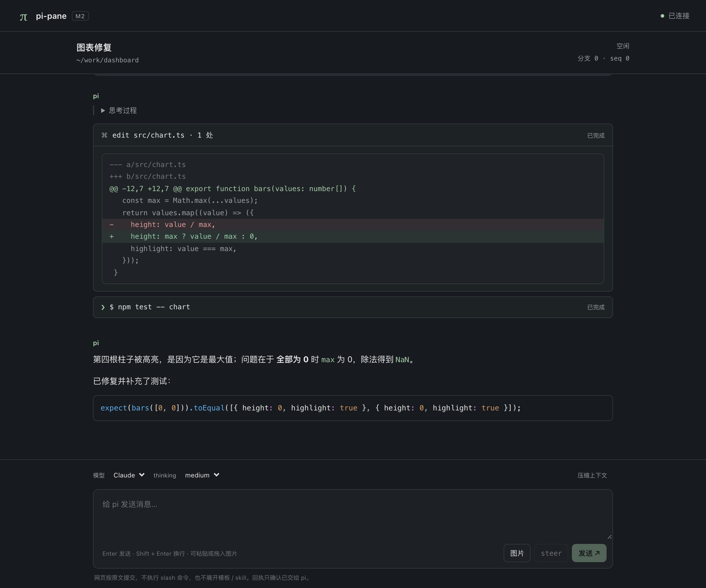

# pi-pane

在 pi 终端里输入 `/web`，浏览器就接上**正在运行的这个会话**：完整历史、实时输出、工具卡片和 diff 都会显示出来，也可以在网页里发消息（含图片）、steer、中止、切模型。终端照常可用，两边看到的是同一个会话。



宿主基线为 pi 1.0.4（Node ≥ 22.19）。设计见 [docs/design.md](docs/design.md)，验收记录见 [M0](docs/m0-status.md)、[M1](docs/m1-status.md)、[M2](docs/m2-status.md)。

## 安装

```sh
pi install npm:pi-pane
```

包内已带预构建的网页，安装时不需要构建。从源码试用：`npm ci && npm run build && pi -e .`。

## 使用

| 命令 | 作用 |
|---|---|
| `/web` | 启动服务（默认 `127.0.0.1:7878` 起找空闲端口）并打开浏览器 |
| `/web --no-open`、`/web --port 7900` | 不打开浏览器；指定端口（占用即报错，不换端口） |
| `/web status` | 地址、连接数（外部访问时还有登录数） |
| `/web stop` | 停止服务，断开所有浏览器 |
| `/web --rotate` | 更换链接，撤销所有登录和连接 |
| `/web qr` | 外部访问时在终端显示链接二维码，两分钟后隐藏 |
| `pi --web` | 启动 pi 时同时启动服务 |

网页里：

- **Enter** 发送，**Shift+Enter** 换行；运行中 Enter 请求 followUp，**⌘/Ctrl+Enter** 请求 steer。触屏设备上 Enter 换行，用按钮发送。
- **图片**：粘贴、拖入或点“图片”。PNG/JPEG/WebP，最多 4 张，单张 ≤ 5 MiB、合计 ≤ 10 MiB、≤ 2,000 万像素；浏览器和扩展各校验一次，损坏或超限的图片会直接报错。历史里的图片只在滚动到附近时加载，浏览器最多缓存 48 MiB。
- 历史默认显示最近 200 条，更早的点“加载更早的消息”；超长内容可“加载全部”。
- 网页按原文提交：不执行 slash 命令，不展开模板或 skill。回执只表示“已交给 pi”，不代表已入队或成功；断线后不会自动重发。

## 从其他设备访问（手机、平板）

默认只监听本机。外部访问需要**同时**满足三项，缺一项都不会启动：

1. 公共 HTTPS 地址：`--public-origin https://host[:port]`；
2. 访问密码：环境变量 `PI_PANE_PASSWORD`（至少 12 个字符；只从环境变量读取，不接受命令行或设置文件）；
3. 加密传输，二选一：
   - **同机 TLS 代理**（推荐），例如 Tailscale Serve：服务只监听回环，由代理提供 HTTPS/WSS。
     ```sh
     PI_PANE_PASSWORD='一个足够长的密码' pi
     /web --proxy --port 7878 --public-origin https://my-mac.tailnet-name.ts.net
     ```
     代理需把 `https://my-mac.tailnet-name.ts.net` 转发到 `http://127.0.0.1:7878`，并原样保留 `Origin` 和 `Sec-WebSocket-Protocol`（例如 `tailscale serve --bg 7878`）。
   - **直接 TLS**：`/web --host 0.0.0.0 --port 8443 --public-origin https://pane.example.com:8443 --tls-cert cert.pem --tls-key key.pem`。证书必须能被访问设备正常验证。

在任一设备打开终端给出的链接（或用 `/web qr` 扫码），再输入密码登录。链接本身不能直接连接会话；登录有效期 8 小时，可在网页“退出登录”，`/web --rotate` 或 `/web stop` 会撤销所有登录。连续输错会被限流。

## 配置

可在 pi 的 `settings.json` 中写默认值（命令参数 > 启动 flags > 设置 > 默认值）：

```json
{
  "piPane": {
    "port": 7878,
    "noOpen": true,
    "publicOrigin": "https://my-mac.tailnet-name.ts.net",
    "proxy": true
  }
}
```

支持的字段：`host`、`port`、`noOpen`、`publicOrigin`、`tlsCert`、`tlsKey`、`proxy`。对应启动 flags：`--web-host`、`--web-port`、`--web-no-open`、`--web-public-origin`、`--web-tls-cert`、`--web-tls-key`、`--web-proxy`。密码不能写在设置里。配置本身不会自动启动服务；扩展只读设置，不改写。

## 安全

- 网页的权限与终端相同：能发消息就能让 agent 执行命令。只把链接和密码给你自己的设备。
- 本机模式使用随机 token，放在链接的 `#` 后面，打开后即从地址栏清除。Host、Origin 精确校验，防 DNS rebinding 和跨站 WebSocket。
- Markdown 中的原始 HTML 不执行，链接只允许 http/https/mailto，模型输出里的远程图片只显示为链接，不加载。页面设置 CSP。

## 已知限制

1. 其他扩展弹出的对话框只能在终端处理，网页只提示有待处理的对话框；扩展自定义的 TUI 渲染在网页里退回通用卡片。
2. 关掉终端，网页就断开；后台运行不在当前范围内。
3. 回执只能确认“已交给 pi”，无法逐条确认入队或失败原因；完整待发队列也看不到，只显示是否非空。
4. 多个浏览器都属于同一用户，都可以提交或中止；没有只读访客或多用户隔离。
5. 外部访问的代理路径以本地 TLS 反向代理验证，尚未用真实 Tailscale Serve 验证。

## 开发与验证

```sh
npm ci
npm run build
npm run typecheck
npm test
```

端到端验收在临时目录中启动真实 pi TUI（PTY），使用本地确定性 provider，不调用真实模型；浏览器部分用 Playwright 驱动本机 Chrome。报告写入 `build-artifacts/`（不提交）。

| 脚本 | 内容 |
|---|---|
| `m0:smoke`、`m0:browser`、`m0:boundaries`、`m0:lifecycle`、`m0:projection`、`m0:performance` | 协议、生命周期、边界与性能（M0/M1） |
| `m1:render`、`m1:a6` | 渲染与内容安全、1,000 条消息基准 |
| `m2:images` | 图片上传与历史图片（A9） |
| `m2:external` | 外部访问、登录、二维码、移动端（A10/A11） |
| `m2:install` | npm 包内容与 `pi install` 安装（A11） |

脚本需要指定构建产物，例如 `PI_M0_EXTENSION=./dist/extension/index.js npm run m2:images`；完整命令见 [docs/m2-status.md](docs/m2-status.md)。

代码结构：`src/extension/`（Hub、Bridge、扩展入口、二维码）、`src/protocol/`（共享协议、校验、资源上限、reducer）、`src/web/`（网页）、`tests/`（单元测试与夹具）、`scripts/`（验收脚本）。
