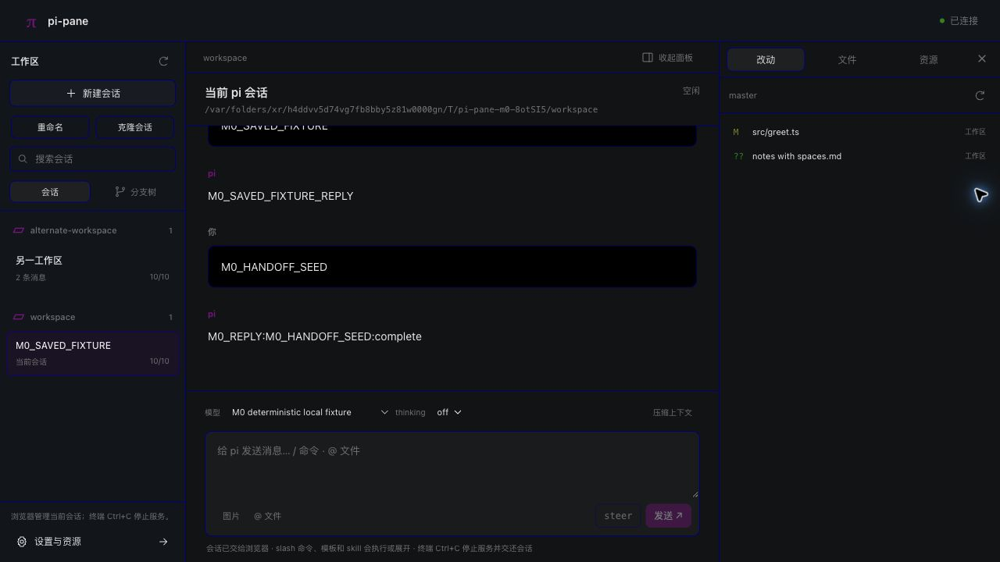
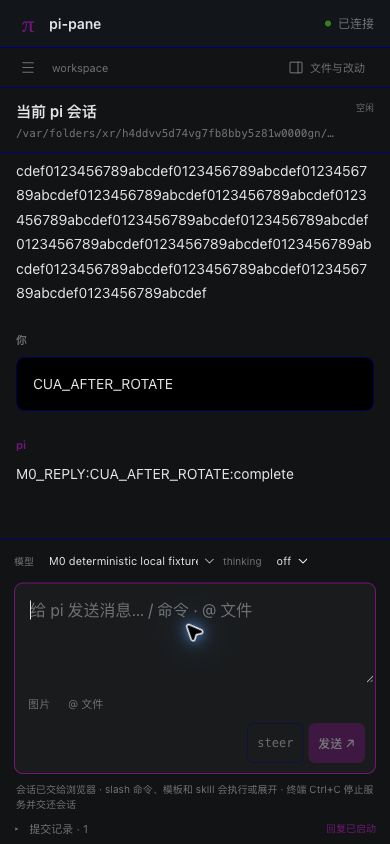

# M3 0.2.0 最终交互验收

结论：**M3 已完成，19/19 项通过。** 日期：2026-10-10（Asia/Shanghai）。本轮没有发现需要修复的产品问题，不修改或重新发布已经冻结的 0.2.0 包。

验收加载正式 npm 安装的 `@lilibonk/pi-pane@0.2.0`，使用真实 pi 1.1.0、macOS arm64 和 Chrome。全部操作通过实际网页控件、键盘及刷新完成，桌面视口为 1280×720，移动视口为 390×844；移动项为响应式浏览器验收，未声称实机手机验收。临时 HOME、agent、会话与工作区均独立，本地确定性 provider 不调用远程模型，也不读取日常凭据。

版本对应源码 `439c545b4293143473cb2a0d42f5dbc073147fa5`。测试加载的 83 个包文件与已发布冻结包逐字节一致，tarball SHA-256：

```text
5bba224d3b106139ee56614e5ec83079ba97f324a56bfc11c29a0656177f2eb0
```

| # | 检查 | 实际结果 |
|---|---|---|
| 1 | 桌面工作台 | 通过；已连接、当前会话标记、两种模型与已有历史均显示 |
| 2 | Git 差异 | 通过；实际临时 Git 文件展示 Hello 删除、Welcome 新增 |
| 3 | 内置命令拦截 | 通过；`/model` 打开模型入口，没有进入 provider 或生成对话气泡 |
| 4 | 文件预览与引用 | 通过；含空格文件名及正文正确，显式引用写入草稿 |
| 5 | 模型与 thinking | 通过；RPC 切换 thinking 模型，选择 high 后状态与回执正确 |
| 6 | 桌面对话框 | 通过；confirm/select/input/editor 返回正确；65538 字节显示 64 KiB 限制并禁用提交，缩短后可提交；Tab 循环与背景 inert 正常 |
| 7 | 扩展 UI 与草稿 | 通过；title/status/widget/editor 显示，编辑后的草稿在同页切换会话并返回后保留 |
| 8 | 重命名与跨 cwd | 通过；名称与当前标记更新，另一工作区仅展示自己的文件，正文正确 |
| 9 | 只读树与用户分叉 | 通过；tree 导航禁用并说明上游限制；用户分叉成功，已有草稿保留，回执可恢复原文 |
| 10 | 移动布局 | 通过；390px 无横向溢出，steer 与发送按钮均为 40px 高且可见 |
| 11 | 移动抽屉 Escape | 通过；抽屉聚焦搜索，Escape 关闭并恢复打开按钮焦点 |
| 12 | 移动编辑器取消 | 通过；编辑双行文本后 Escape 取消，未提交值，服务继续可用 |
| 13 | 空分叉克隆拒绝 | 通过；明确提示尚未保存，服务保持连接，下一条消息成功 |
| 14 | 已保存分支克隆 | 通过；新当前会话生成，原用户与回复历史保留 |
| 15 | 移动嵌套焦点 | 通过；抽屉 Tab/Shift+Tab 循环；叠加扩展框后背景 inert，回答后回抽屉，Escape 回打开按钮 |
| 16 | 双页面对话框 | 通过；两个页面显示同一待处理框，在一页回答一次后两页同步关闭 |
| 17 | 待处理框刷新 | 通过；刷新重连后恢复输入框，提交结果只处理一次 |
| 18 | 流式响应刷新 | 通过；可见 partial 期间刷新，继续生成至完整结果，仅一条用户消息与一条回复 |
| 19 | 凭据轮换与刷新 | 通过；发起页刷新后仍已连接并可继续对话，旧页面显示凭据已轮换、需要重新连接 |

双页面控制台错误均为 0。事件日志另外核对了 `/model` 没有进入 provider、四类对话框的返回值、移动编辑器取消、刷新输入只处理一次、慢流 provider 调用/结束各一次（约 19.62 秒）、轮换后的消息成功。双页面验收未扩展为两页同时提交的 UI 竞态测试。慢流完整文本与确定性 provider 输出逐字匹配。

临时服务、RPC 子进程、监听端口、会话锁、私有访问文件和 fixture 根目录均已清理，浏览器验收页面已关闭，临时视口覆盖已重置。原始本地证据位于 `build-artifacts/releases/0.2.0/cua/`：`browser-report.json`、`checks.json`、`event-audit.json`、`events.jsonl`、`console-errors.json`、`package-hashes.json`、`cleanup.json` 和阶段截图。该目录被 Git 忽略；本页及下方截图是随源码提交的验收摘要。

本轮仅补齐最终 CUA 与收尾文档；此前同一冻结候选的 136/136 单元、125/125 确定性矩阵、5/5 真实模型试用和 5/5 公共安装验证仍分别记录于 [M3 状态](m3-status.md)，没有合并计数或声明本轮重跑。




