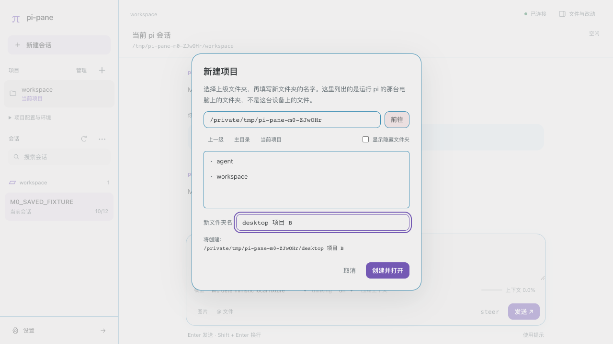
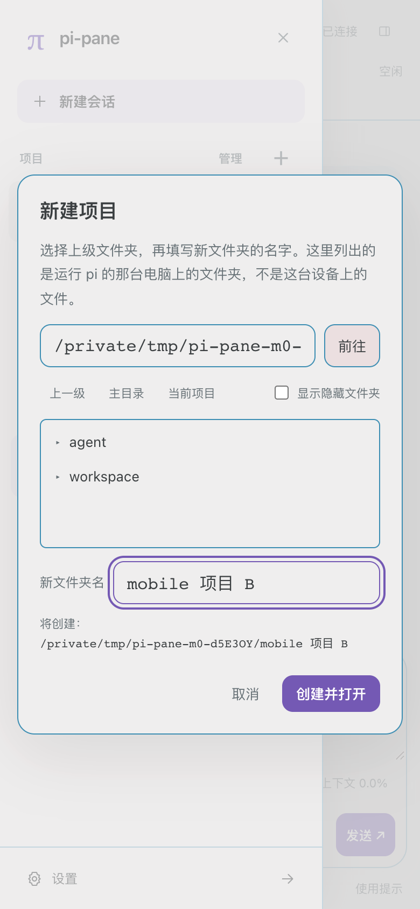
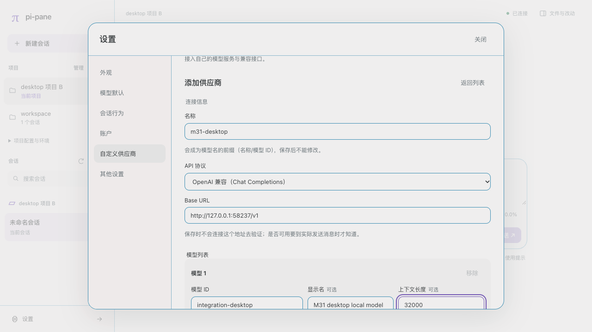
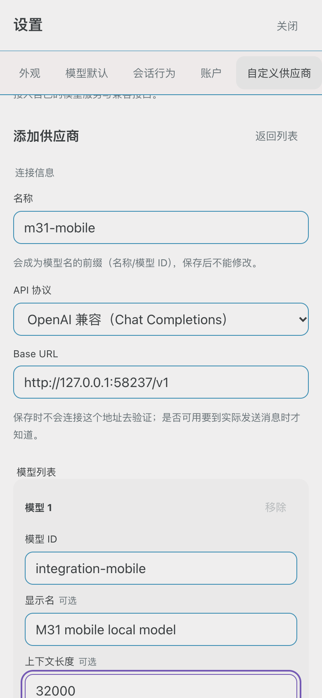
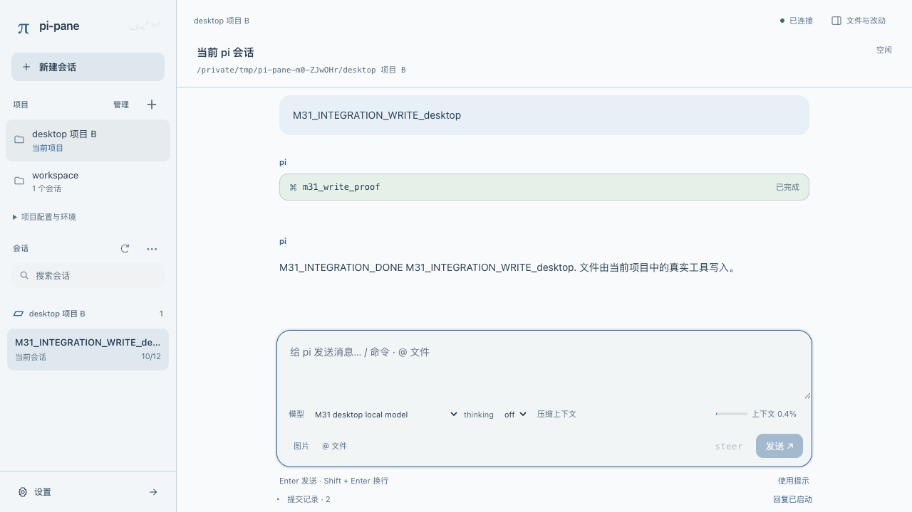
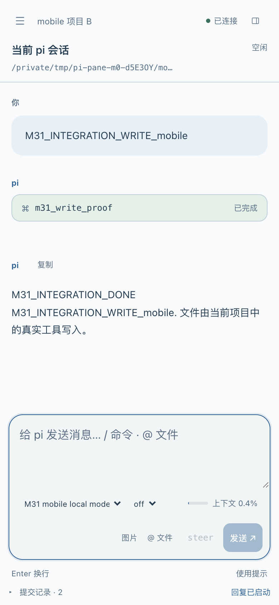
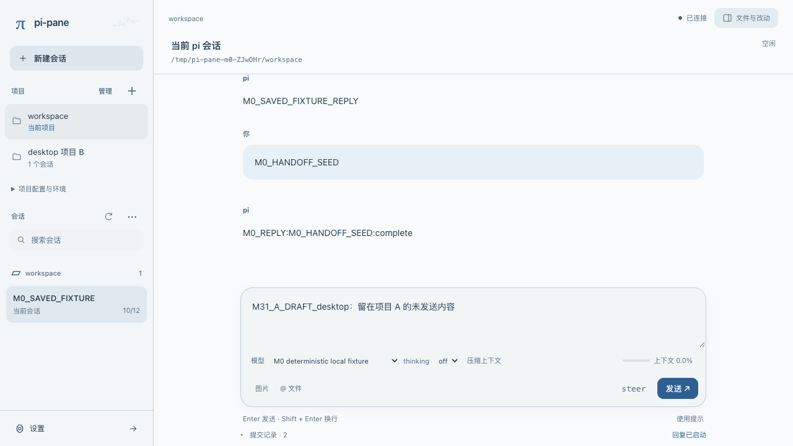
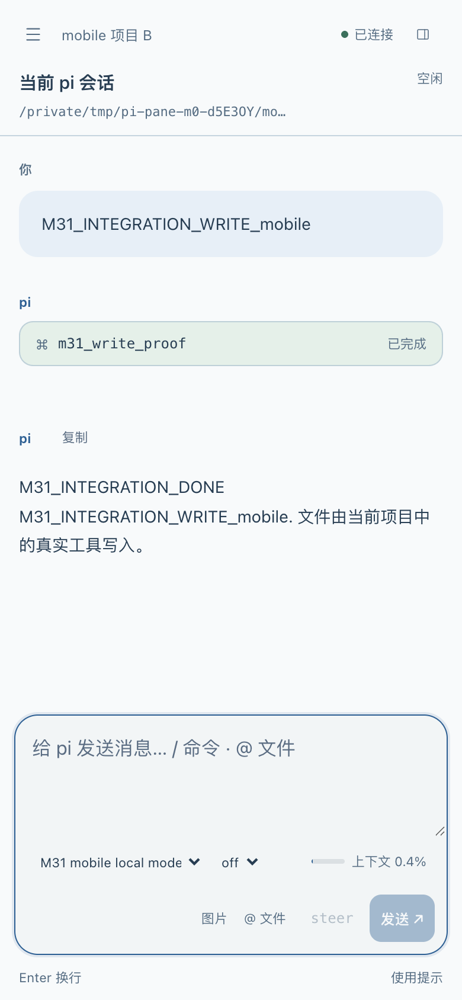

# M3.1 技术门槛验证记录（G1–G5）

日期：2026-10-10。对应[详细计划](m3.1-plan.md)第 10 节。基线：pi / pi-ai 1.1.0，pi-pane 分支 `m3.1/gates`。本文记录**已运行的隔离原型**的观察结果和据此作出的决定，不是产品实现验收。

## 1. 方法与范围

- 每个脚本自建临时 HOME、agentDir、项目目录和事件日志，环境变量走白名单，`PI_OFFLINE=1`，使用仓库里的确定性 provider；不读取日常凭据，不调用真实模型，结束后删除临时目录。
- 子进程是标准 `pi --mode rpc`（包导出的 `rpc-entry`），只用公开的 JSONL 协议；宿主侧只用包根公开导出（`ModelRuntime`、`SettingsManager`、`ProjectTrustStore`、`DefaultResourceLoader`）。
- 脚本记录的是观察结果：与预期不符的结果会被标出而不是隐藏。机器可读结果在被 Git 忽略的 `build-artifacts/m3.1/gates/`。

```sh
node --import tsx scripts/m31-g1.mjs
node --import tsx scripts/m31-g2.mjs
node --import tsx scripts/m31-g3.mjs
node --import tsx scripts/m31-g4g5.mjs
```

| Gate | 观察项 | 结果 | 结论 |
|---|---|---|---|
| G1 新项目与空会话 | 8 | 8 项与预期一致 | 通过，选定候选 A |
| G2 信任、参数和生命周期 | 16 | 16 项与预期一致，其中 1 项纠正了此前的静态判断 | 核心事实已证实；3 项未覆盖 |
| G3 认证公共接口 | 13 | 13 项与预期一致，其中 1 项证实了命令执行风险 | API key 闭环通过，选定进程内应用；OAuth 流程未覆盖 |
| G4 设置与主题 | 10 | 10 项与预期一致 | 落盘语义通过；3 项未覆盖 |
| G5 自定义供应商与会话补齐 | 11 | 11 项与预期一致，其中 2 项纠正了预期 | 读取侧语义通过；宿主写入属产品代码，待实现时验收 |

“未覆盖”的事项见第 7 节，仍是开工后的待办，不计为通过。

## 2. G1 新项目与空会话

| ID | 观察 |
|---|---|
| G1-A1 | 候选 A（不传 `--session`）：子进程在全新项目里自行给出预分配路径，位于 pi 自己的会话目录；会话目录已由 pi 创建，文件尚不存在。 |
| G1-A2 | `get_state` 之后可以加锁并登记 writer PID；随后切换模型、命名会话、执行 `bash pwd` 都不产生文件；工具实际 cwd 等于目标项目。 |
| G1-A3 | 第一条真实消息落盘后，header 的 cwd 与 id 分别等于目标项目和 `get_state` 的 sessionId；锁的追加归属校验通过；`process.cwd()` 与 `ctx.cwd` 都等于目标项目。 |
| G1-A4 | 关闭 stdin 后子进程约 5 毫秒内以 0 退出；另起一个标准 pi 进程可用 `--session` 重新打开，会话 ID 不变。 |
| G1-B1 | 候选 B：会话目录不存在时，现有锁实现以 `ENOENT` 失败。 |
| G1-B2 | 候选 B 能启动未落盘会话，但 sessionId 与预分配文件名里的 UUID **不相等**，之后的 `new_session` 落在预分配文件所在目录。 |
| G1-C1 | 项目 `.pi/settings.json` 的 `sessionDir` 在候选 A 下被原生采用，宿主无需计算。 |
| G1-C2 | 候选 B 下首个文件在宿主选的目录，之后的新会话在项目设置的目录，两者分叉。 |

**决定：选定候选 A。** 候选 B 有三处实际缺陷（锁失败、ID 与文件名不一致、目录分叉），不再保留。空项目的加锁时机定为“子进程启动并返回 `get_state` 之后、第一条消息之前”。

## 3. G2 信任、参数和生命周期

| ID | 观察 |
|---|---|
| G2-T1 | 含需信任资源的未知项目，RPC 子进程不加载其项目扩展。 |
| G2-T2 | 通过公开 `ProjectTrustStore` 写入的信任，下一个子进程生效。 |
| G2-T3 | 全局扩展的 `project_trust` 回答“否”时，已存储的“是”被否决。 |
| G2-T4 | `--approve` 完全跳过全局扩展的 `project_trust` 事件。 |
| G2-T5 | `--no-approve` 使已存储信任的项目不加载。 |
| G2-T6 | 带 `--approve` 启动于项目 B 的子进程，原生 `switch_session` 到项目 C 的会话后，C 的项目扩展**被加载**；此时 `ctx.cwd` 与工具 cwd 是 C，`process.cwd()` 仍是 B。 |
| G2-T7 | 不带覆盖时，同样的切换不会信任 C。 |
| G2-T8 | 扩展命令可以让子进程自行切到另一项目的会话；宿主只能事后从 `get_state` 发现。 |
| G2-T9 | `get_state` 的字段里既没有 cwd，也没有信任结果。 |
| G2-M1 | 以 `--model` 加 `--session` 恢复时，启动参数的模型覆盖会话里保存的模型；不带 `--model` 时恢复会话里的模型。 |
| G2-S1 | 关闭 stdin 后 `session_shutdown` 处理函数完整执行，退出码 0。 |
| G2-S2 | 处理函数耗时 3.5 秒时子进程等它结束后才退出：等多久由宿主决定。 |
| G2-S3 | 关闭阶段追加的条目在 stdin 关闭后写入文件，此时子进程已退出，无法再用 `get_entries` 核对。 |
| G2-S4 | 关闭阶段弹出对话框时，宿主能在 stdin 关闭后看到这条 `extension_ui_request`；子进程约 4 毫秒后**自行以 0 退出**，对话框从未被回答，处理函数被截断。 |
| G2-S5 | 同样的对话框出现在进程内会话替换（`new_session`）期间时，可以正常回答，替换完成。 |
| G2-S6 | 扩展可以否决进程内替换；否决后原会话不变。 |

**G2-S4 纠正了计划里的一处静态判断。** 计划原写“等到上限后强制结束”；实测子进程不会挂起，而是立即以 0 退出并丢弃未完成的关闭处理。因此**退出码 0 不能当作关闭处理已完整执行的证据**。可用的判定信号是：stdin 关闭之后是否还出现过对话框请求。

**决定：**

- 宿主从不生成 `--approve`，不提供“仅本次信任”（T4、T6）。
- 子进程自行跨 cwd 切换不得静默接受，默认失败关闭（T6、T8）。
- 界面把“用户的选择”和“实际加载情况”分开显示，后者只能从命令与资源来源推断（T3、T9）。
- 重建同一会话时不重放 `--provider`/`--model`/`--thinking`（M1）。
- 计划停止：stdin 关闭后若观察到对话框请求，判定该次停止不完整，不激活目标，进入 recovery_required 并说明原因；等待上限只针对慢处理函数（S2、S4）。
- 关闭窗口内的追加无法证明归属，按计划第 8 节的有界接受规则处理（S3）。
- 凭据与设置的应用优先走进程内替换，它保留对话框应答和扩展否决（S5、S6）。

## 4. G3 认证公共接口

| ID | 观察 |
|---|---|
| G3-A1 | 登录前，RPC 子进程不提供未认证内置 provider（以 OpenAI 为例）的任何模型。 |
| G3-A2 | 宿主用 `ModelRuntime.login` 经一次 secret 提示保存 API key：只改该 provider 的条目，其他 provider 原样保留，文件权限 0600，期间没有任何扩展事件；`listCredentials` 不含密钥。 |
| G3-B1 | 保存后，运行中的子进程不会自己看到新凭据。 |
| G3-B2 | 未落盘会话：原生 `new_session` 后模型出现，同一进程，当前模型不变。 |
| G3-B3 | 已落盘会话：对同一文件发原生 `switch_session`，登出与登录都能应用；会话 ID、当前模型、历史消息保持不变。 |
| G3-B4 | 扩展否决时替换被取消，旧运行时仍能回答，凭据保持已保存。 |
| G3-B5 | 回退路径（重启子进程并 `--session` 恢复）同样生效，模型从会话恢复。 |
| G3-C1 | **风险证实**：把以 `!` 开头的原始字符串交给官方登录，它被当作宿主命令执行。 |
| G3-C1b | 按 pi 的转义规则（`$` 写成 `$$`，开头的 `!` 写成 `$!`）处理后，8 种输入（含 `!命令`、`$HOME`、`${PATH}`、引号、换行）都解析回用户输入的原文，没有命令被执行。 |
| G3-C2 | 回答前取消：登录被拒绝，已存凭据不变。 |
| G3-C3 | 登出只删除该 provider 的条目。 |
| G3-D1 | 哨兵密钥没有出现在子进程输出、stderr 或夹具事件中。 |
| G3-E1 | 元数据可列出各内置 provider 支持的登录类型：OpenAI、Anthropic、Kimi 同时支持 API key 与 OAuth，Google、Qwen 只有 API key，OpenAI Codex 只有 OAuth。 |

**决定：**

- 凭据应用选定**进程内原生替换**：未落盘会话用 `new_session`，已落盘会话对当前文件发 `switch_session`；换子进程只作回退。
- 网页输入的 API key **必须**先按 pi 的转义规则转成字面值再交给官方登录；这是硬性要求，不是可选加固。
- 账户列表只用 `listCredentials` 与 provider 元数据，不调用会解析密钥的接口。

## 5. G4 设置与主题

| ID | 观察 |
|---|---|
| G4-S1 | 全局 setter 只写自己的字段，未知字段和无关字段保留。 |
| G4-S2 | manager 创建后被外部进程改动的其他字段不会被旧值写回。 |
| G4-S3 | 同一字段被外部改动后，官方写入后写生效，没有比较并交换。 |
| G4-S4 | 设置文件只读时 `flush()` 仍然 resolve，错误只在 `drainErrors()` 里；内存值已变而磁盘未变。 |
| G4-S5 | 设置文件损坏时读取报错，setter 不会覆盖它。 |
| G4-S6 | 项目有覆盖时全局写入成功但有效值仍是项目值；`projectTrusted: false` 时看不到项目值。 |
| G4-R1 | RPC 的 `set_steering_mode`、`set_follow_up_mode`、`set_auto_compaction`、`set_auto_retry` **都会同时写入全局默认**；`get_state` 没有重试字段。 |
| G4-R2 | RPC 的 `set_model`、`set_thinking_level` 不写全局默认。 |
| G4-T1 | 公开 `DefaultResourceLoader` 在 `noExtensions` 下能发现用户主题并给出损坏主题的诊断，项目扩展没有被执行；主题目录的子目录不会被当作主题。返回的只有自定义主题，不含内置主题。 |
| G4-I1 | `images.blockImages` 对经 RPC `prompt` 发送的图片生效。 |

**决定：**

- 保存成功的判定维持“flush、`drainErrors` 无错、重新读盘确认”三者同时满足（S4）。
- 会话行为四项开关在界面上标明“同时保存为全局默认”（R1）。
- 主题发现采用 `noExtensions` 的公开加载器；内置主题名单另由宿主维护（T1）。
- 装饰清单放在主题目录之外的独立顶层目录，不与主题文件混放。T1 显示子目录不会被误认，但独立目录更不依赖这一实现细节。
- `images.blockImages` 纳入本期可编辑清单；`images.autoResize` 未验证，保持只读。

## 6. G5 自定义供应商与会话补齐

| ID | 观察 |
|---|---|
| G5-P1 | 写入 `models.json` 的 provider，运行中的子进程下一次列模型时**立即可见**，不需要应用；应用后保持。 |
| G5-P2 | 编辑与删除在应用后生效。 |
| G5-P3 | provider 级与顶层的未知字段不影响加载。 |
| G5-P4 | `models.json` 损坏时子进程继续运行、可正常启动，自定义 provider 消失，其他 provider 不受影响。 |
| G5-K1 | `apiKey` 以 `!` 开头时，仅列模型不会执行命令（文档说明在请求时执行）。 |
| G5-K2 | 转义后的字面密钥不会被执行。 |
| G5-K3 | `models.json` 的条目可以不含密钥：以带 `modelsPath` 的宿主 `ModelRuntime` 走官方登录，密钥存入官方凭据文件，应用后模型可用。 |
| G5-N1 | 与内置 provider 同名时，文件里的模型被**并入**内置列表（44 变 45），内置模型没有被替换；同名条目的 Base URL 等设置作用于整个内置 provider。 |
| G5-E1 | `export_html` 不带路径时返回相对文件名，文件落在**子进程的工作目录即项目目录**；带路径时写到指定位置。 |
| G5-E2 | `get_session_stats` 给出消息数、token 分项、费用和上下文占用；`get_last_assistant_text` 给出最后一条回复。 |
| G5-D1 | 被 `/web` 宿主持锁的会话可用现有 `SessionFileLock.inspect` 检出；本机有 `trash` 命令。 |

**决定：**

- 自定义供应商的密钥存入官方凭据文件，`models.json` 条目不写 `apiKey`（K3）。密钥同样先转义。
- 表单拒绝与内置 provider 同名：同名的实际语义是改写内置 provider 的端点并追加模型，不是新增供应商（N1）。
- 保存后统一执行应用步骤，尽管列表会提前变化（P1）；界面状态以应用结果为准。
- 导出**始终传入宿主指定的输出路径**，不使用默认位置，避免在用户项目目录里留下文件（E1）。
- JSONL 导出没有 RPC 命令，本期只交付 HTML。

## 7. 尚未覆盖

以下事项本轮没有运行验证，仍是实现阶段的待办：

- **G2**：相对的 `-e`/skill/template/theme 路径与自定义 flag 在跨项目时的行为（`LaunchProfile` 已有单元测试，尚无真实子进程下的端到端验证）；空闲复核后扩展自行发起回合的竞争（有界接受规则会拒绝关闭窗口内出现的消息条目，已有单元测试，尚无真实扩展触发的端到端验证）。有界接受规则、计划停止与恢复流程已随 M31-1 实现并验证，见第 8 节。
- **G3**：用合成授权服务验证 device、callback、manual 三类 OAuth 流程，以及取消与端口释放；发起页断线重连、非发起页取消（属 pi-pane 代码）；真实 provider 试用需另行授权。
- **G4**：包内主题与项目主题的发现；真实多进程并发写；主题校验器是否启用。
- **G5**：宿主对 `models.json` 的结构化读改写（属产品代码）；导出文件的下载通路与大小上限。

## 8. M31-1 运行时控制的实施验证

2026-10-10 实现后运行。与前面的原型不同，这里验证的是产品代码。

- 单元测试 162 项通过，其中宿主替换、恢复与监督 9 项，锁的关闭窗口接受规则 2 项，子进程停止结果 1 项，Hub 的宿主状态与宿主命令 1 项。
- `npm run m31:runtime`：真实 pi TUI 与真实 RPC 子进程，8 项通过，报告在 `build-artifacts/m3.1/runtime/report.json`。
- 原 M3 回归 `m3:handoff`、`m3:workbench` 通过；其中“跨工作区恢复”一项现在走的是换子进程。
- 恢复页面在浏览器中实际显示并操作过一次（恢复上一个会话）。

| 编号 | 实测结果 |
|---|---|
| R1 | 切到另一项目的会话时，宿主停掉旧子进程并在目标目录启动新子进程：新进程的 `process.cwd()` 与 `ctx.cwd` 都是目标项目，旧进程的关闭处理完整执行，宿主进程、Hub 和已连接页面都没有中断，旧会话的锁释放、新会话的锁登记了新进程。 |
| R2 | 换过之后的子进程只写自己项目的会话文件，原项目的会话文件长度不变。 |
| R3 | 子进程通过扩展命令自行切到另一项目的会话时，服务停止，终端打印的恢复命令指向子进程实际停在的那个会话及其目录，两把锁都释放，没有任何进程被重启。 |
| R4 | 关闭阶段弹对话框的扩展存在时，切换命令以 `recovery_required` 失败：目标子进程没有启动，目标会话没有被加锁，原会话的锁保留；此时新打开的页面先收到宿主状态，再收到“没有会话”。 |
| R5 | 在恢复状态下执行“恢复上一个会话”，新子进程打开原会话，历史完整，可继续对话。 |
| R6 | 在恢复状态下执行“停止服务”，宿主以 0 退出并打印恢复命令，不出现“子进程意外退出”的提示。 |
| R7 | 关闭处理耗时 3 秒时，宿主等它完成而不是按紧急退出的 2 秒发信号；它在关闭窗口写入的一条非消息条目被接受，并在终端注明“归属无法核对”。 |
| R8 | 换过子进程之后按 Ctrl+C，停掉的是当前子进程，恢复命令指向当前项目的会话。 |

实现时相对计划的三处收紧或调整，已回写主计划：

- 有界接受规则拒绝关闭窗口内出现的**任何**消息条目（不只 user/assistant），并拒绝不完整的末行和被替换的文件。
- 交接时也不再把启动参数里的模型重放到已落盘的会话上；模型以会话记录为准，与交接前不同则在终端和页面提示。
- 恢复操作走单独的 `host_command` 信封，沿用同一租约的编号与回执去重，按宿主状态版本校验而不是会话 epoch。

## 9. M31-2 项目闭环的实施验证

2026-10-10 实现后运行，验证的是产品代码。

- 单元测试 180 项通过，其中项目服务 6 项、宿主的项目命令 8 项、草稿隔离与协议参数 3 项、Hub 的宿主查询 1 项、项目注册表 6 项。
- `npm run m31:projects`：真实 pi TUI 与真实 RPC 子进程，13 项通过，报告在 `build-artifacts/m3.1/projects/report.json`。
- 回归：`m31:runtime` 8 项、`m3:handoff`、`m3:workbench`、`m0:browser` 通过。
- 页面在浏览器中实际操作过一遍，桌面 1280 宽和手机 390 宽各一次：打开项目、目录选择、信任询问的两种回答、从列表切换、新建项目、草稿随项目保留。这是人工查看，没有自动化脚本。

逐项对照项目附录的验收编号。“端到端”指 `m31:projects` 或 `m31:runtime` 用真实 pi 跑过；“单元”指只有替身子进程下的测试。

| 编号 | 状态 | 依据与缺口 |
|---|---|---|
| P-01 | 通过 | 端到端。空目录打开后 0 会话、无消息，登记写入磁盘。没有实际重启服务后再看一次，只核对了登记文件。 |
| P-02 | 通过 | 端到端。含中文、空格、引号和 shell 元字符的名字按字面创建；同名、父目录不存在、名字含 NUL 都不改动任何东西。无权限的父目录只有单元测试。 |
| P-03 | 通过 | 端到端。软链接打开的是真实目录且只登记一次；目录移走后标为不可用，不会落到同名目录，重新定位需用户选择。 |
| P-04 | 通过 | 端到端。第一条消息前没有会话文件且路径已加锁；第一条消息后文件头的 cwd 正确。原生可恢复是用公开的 `SessionManager.open` 核对的，没有另起一个 pi TUI。 |
| P-05 | 部分 | 端到端核对了进程目录、会话目录、项目模板、文件列表和模型。AGENTS、项目设置、技能、项目扩展、工具的相对路径没有逐项核对。 |
| P-06 | 通过 | 端到端。未回答不离开原项目；“不加载继续”不记录、下次再问；“信任并记住”写入信任记录并实际加载；没有任何子进程带 `--approve`。父目录继承和显式拒绝只有单元测试。 |
| P-07 | 通过 | 端到端。起始 `--approve` 不带到其他项目；全局策略扩展否决时，界面数据是“已选择信任、实际加载 0 项”。 |
| P-08 | 部分 | 端到端核对了已落盘会话不重放 `--model`、新会话保留启动模型、初始提示不重放。相对的 `-e` 等路径和 `--session-dir` 只有单元测试。 |
| P-09 | 通过 | 端到端。回复进行中拒绝切换；两个页面同时切换只有一个成功，另一个得到“状态已过期”。待答对话框期间的拒绝只有单元测试。 |
| P-10 | 通过 | 端到端。目标会话被别的持有者加锁时拒绝，原项目可继续对话。切换途中停止服务时的锁清理只有单元测试。 |
| P-11 | 部分 | 换子进程不关 Hub 已端到端验证。“启动门前后宿主崩溃无孤儿写进程”只有 M3 回归里针对首次交接的那一项，没有针对换子进程窗口的崩溃注入。 |
| P-12 | 部分 | 关闭阶段弹对话框是端到端；目标启动失败、关闭窗口追加消息条目是单元；目标目录消失是端到端（拒绝且不离开）。只读查询超时没有专门用例。 |
| P-13 | 部分 | 多次切换后的 Ctrl+C 是端到端：子进程全部退出、锁全部释放、恢复命令指向最终会话。切换进行到一半时的停止只有单元测试，SIGHUP 没有在切换后重测。 |
| P-14 | 部分 | 桌面和 390 宽各人工操作一遍，无横向溢出，对话框内焦点受限、回车可提交、关闭后焦点返回。没有自动化；失败流程和纯键盘操作没有在手机宽度下逐项走。 |
| P-15 | 通过 | 从列表移除不删目录和会话、历史不会把它带回来是端到端；两个宿主并发登记不丢条目是注册表的单元测试。 |
| P-16 | 通过 | 目录列表只有文件夹名、凭据目录与 agent 目录（含软链接别名）被拒是端到端加单元；未认证的连接拿不到目录列表是 Hub 单元测试。 |
| P-17 | 部分 | 同项目内扩展否决新建会话仍有效（M3 回归）；子进程自行跨项目切换会停服务（`m31:runtime`）。跨项目换子进程不询问扩展是否否决，这是已写明的差异，不是等价实现。 |
| P-18 | 通过 | 草稿和图片按项目保存与取回：单元测试加一次浏览器实测。只存在内存里，刷新页面后清空，与此前一致。 |

实现时的几处取舍，已回写主计划：

- 目录选择、项目列表和信任状态走新的 `host_query`，不依赖正在运行的会话；项目命令沿用 `host_command`。
- 侧栏默认只列当前项目的会话，搜索时才跨项目。
- 项目列表只在用户明确操作时写盘：打开、新建、移除、重新定位；另外在离开一个项目时记下它最后的已保存会话。
- 从会话列表点开另一个项目的会话不算信任决定：不询问、不记录、不带任何信任参数，项目配置按 pi 无界面时的规则不加载，侧栏提供“选择…”入口。
- 凭据类目录的拦截同样作用于跨项目的会话切换。

## 10. M31-3 认证闭环的实施验证

2026-10-10 实现后运行，验证的是产品代码。

- 单元测试 198 项通过，其中认证控制器 11 项（含一项直接调用 pi 自己的登录代码）、宿主的账户应用 6 项、Hub 的账户消息 1 项。
- `npm run m31:auth`：真实 pi TUI、真实 RPC 子进程和 pi 自己的登录代码，离线、哨兵密钥，9 项通过，报告在 `build-artifacts/m3.1/auth/report.json`。
- `npm run m31:auth-real`：经维护者授权，用本机已有的一个临时 API key（`qwen-token-plan-cn`，模型 `qwen3.8-flash`）跑了一次，5 项通过，发出 1 次真实模型请求，报告在 `build-artifacts/m3.1/auth-real/report.json`。
- 回归：`m31:runtime`、`m31:projects`、`m3:handoff`、`m3:workbench`、`m0:browser` 通过。
- 账户页面在浏览器中人工操作过一遍（桌面 1280 宽）：`/login` 打开账户页且不发给模型、查找服务商、API key 登录对话框、保存后自动应用、退出。用的是自己编的假密钥。

### 真实验证做了什么、没做什么

- 脚本在进程内从授权的凭据文件读出密钥，经回环连接作为登录步骤的回答提交一次；密钥没有被打印，也没有写进报告。验证结束后核对：授权文件的哈希与修改时间不变，临时 agent 目录已删除，浏览器收到的全部消息、终端输出、夹具事件和会话文件里都没有这个密钥。
- 流程：登录前该服务商未配置、0 个模型 → 提交密钥 → pi 保存并在进程内应用 → 模型列表出现 20 个模型 → 选定模型发一条短提示并收到含随机串的回复 → 退出 → 模型消失。
- **没有做**：密钥没有经浏览器页面的输入框录入（页面输入只用假密钥验证过）；没有任何设备码 OAuth 的真实登录，这需要有人用真实账户在服务商页面上批准。

### 实现中的三处发现

- **列账户状态不能让 pi 刷新可用性。** 实测 `ModelRuntime.create` 在默认的 `refreshOnCreate: true` 下会解析已存的密钥，凭据文件里一条 `!touch …` 的密钥因此被执行。宿主一律用 `refreshOnCreate: false`，状态只来自 pi 的凭据清单（已存的类型）和运行中会话的模型列表。代价是分辨不出“由哪个环境变量提供”，界面只能写“来自环境变量、启动参数或扩展”。
- **只有密钥字段被转成字面值。** pi 只把凭据里的 `key` 当配置值解析。密钥登录里的其他字段（账号、网关 ID 等）不转义，但如果以 `!` 开头或含 `$` 引用就拒绝；登录返回后再核对一次已存的 `key` 是字面值，否则立即删除并报错。
- **需要本机回调的 OAuth 没有在网页开放。** 按源码里各登录用到的交互类型分类：`kimi-coding`、`github-copilot`、`xai`、`meta` 只用设备码；Anthropic、OpenAI、OpenAI Codex、OpenRouter、Radius 的订阅登录需要本机回调，网页显示“请在终端运行 /login”，已有凭据照常可用。
- **设备码登录已于 2026-10-11 按维护者决定关闭。** 四家设备码服务商没有一家用真实账户走通过，按“验证过才算支持”的要求，网页不再提供任何 OAuth 登录，只保留 API key 登录；这四家显示“网页登录尚未用真实账户验证，暂不开放”。实现保留，由宿主的一个默认为空的名单控制，做真实验证时逐家打开。

### 逐项对照认证附录的验收编号

| 编号 | 状态 | 依据与缺口 |
|---|---|---|
| AUTH-01 | 通过 | 端到端。未配置时如实显示，列表不含任何密钥，不触发登录或模型请求。 |
| AUTH-02 | 通过 | 端到端。只改所选服务商的条目，文件权限 600，应用后模型可选，密钥不在消息、终端、事件、会话文件里。没有重启宿主后再看一次。 |
| AUTH-03 | 部分 | 其他服务商的条目保持原样已验证；“替换已有密钥后下一次请求用新值”没有专门用例。 |
| AUTH-04 | 部分 | text、secret、select、manual_code 四类步骤以及未知选项、旧步骤、跨操作回答的拒绝是单元测试；浏览器里只实际看过 secret 这一种，手机键盘没有看。 |
| AUTH-05 | 部分 | 设备码的展示、等待、批准、取消、到期是用脚本化的登录做的单元测试。服务商拒绝、网络中断、轮询间隔属于 pi 的代码，没有搭合成授权服务去跑，也没有真实设备码登录。 |
| AUTH-06 | 部分 | pi 撤回手动回填步骤时网页步骤随之消失是单元测试。回调端口被占不适用：回调类登录没有在网页开放。 |
| AUTH-07 | 部分 | 回答前取消、交换过程中取消都不留下任何保存是单元测试。“已保存但同步失败”按已保存处理是代码路径，没有注入用例。 |
| AUTH-08 | 通过 | 同一步只接受一次回答（单元）；非发起页拿不到步骤、不能回答、可以取消（端到端）。 |
| AUTH-09 | 部分 | 发起页断线后用原租约重连能看到未答步骤并完成是端到端；绝对上限、租约失效、令牌轮换触发取消是单元。没有真的断开几分钟，也没有在手机后台验证。 |
| AUTH-10 | 通过 | 端到端。回复进行中登录不受阻，保存后保持待应用，回复不被打断，回复结束也不自动应用，用户触发后才应用。 |
| AUTH-11 | 部分 | 扩展否决后凭据仍保存、原会话可用、可重试是替身子进程下的单元测试。进程内应用失败后自动回退到换子进程没有实现，失败时保持“待应用”。 |
| AUTH-12 | 未覆盖 | 另一个进程同时刷新 OAuth 令牌的并发没有验证。写入走的是 pi 自己的带锁存储。 |
| AUTH-13 | 部分 | 退出只删已存条目是端到端。由扩展提供的服务商显示为“未保存凭据、当前会话可用”已验证；纯环境变量来源没有专门用例。 |
| AUTH-14 | 部分 | 凭据路径固定为有效 agentDir 下的文件，协议拒绝任何多余字段。两个宿主、不同 agentDir 的场景没有跑。 |
| AUTH-15 | 通过 | 八种输入的单元测试、pi 自己的解析器回读、以及端到端里 `!touch` 和 `$HOME` 两种密钥；列举服务商不执行已存的命令型密钥。含换行的密钥本轮没有重测（G3 原型测过）。 |
| AUTH-16 | 部分 | 哨兵不在浏览器消息、终端、事件、会话文件、项目列表里是端到端；错误信息里回显的输入被替换是单元；页面 DOM 和浏览器存储里没有密钥是一次人工检查。同步错误携带凭据的路径没有注入。 |
| AUTH-17 | 部分 | 登录等待中按 Ctrl+C，服务停止、子进程退出、没有保存是端到端（API key 登录）。带真实轮询的 OAuth 只有中止信号层面的单元测试。 |
| AUTH-18 | 部分 | 没有令牌的连接拿不到宿主查询结果是 Hub 单元测试，账户消息走同一套租约校验。外部 HTTPS 下的过期和错误来源没有针对账户接口重测。 |
| AUTH-19 | 部分 | 真实 API key 闭环完成一次（见上）。真实设备码 OAuth 没有做。按计划，这一项补齐之前不能宣称网页认证目标完成。 |

## 11. M31-4 主题与设置的实施验证

2026-10-11 实现后运行，验证的是产品代码。

- 单元测试 225 项通过，其中主题目录 9 项、设置控制器 9 项、宿主的主题与设置 4 项、浏览器外观偏好 4 项、协议参数 1 项。
- `npm run m31:settings`：真实 pi TUI 与真实 RPC 子进程，离线、确定性 provider，12 项通过，报告在 `build-artifacts/m3.1/settings/report.json`。
- 回归：`m31:runtime`、`m31:projects`、`m31:auth`、`m3:handoff`、`m3:workbench`、`m0:browser` 通过。
- 设置弹窗在浏览器中人工操作过一遍，桌面与 375 宽各一次：预览主题、Esc 取消后恢复、保存为此浏览器的外观后刷新仍在、保存 pi 默认主题（磁盘与页面一致，浏览器外观不变）、会话行为开关的保存、只读设置、账户分类、输入 `/settings` 打开弹窗且不发给模型。只在深色主题下看过。

### 实现方式与三处发现

- **主题目录不使用 pi 的资源加载器，也不使用包管理器。** G4 原型用的 `DefaultResourceLoader` 在 `reload()` 时会调用包管理器解析包：缺失的包会被自动安装，未安装在托管目录的用户级 npm 包还会同步执行一次 `npm root -g`（命令来自设置里的 `npmCommand`）。仅仅为了列主题不能触发这些。宿主改为自己读固定的几个位置，用 pi 公开的 `Theme` 类构造主题：有界读取（256 KiB、普通文件、不等待 FIFO）、与 pi 相同的变量解析和可选色回退，并补上 pi 只在 TUI 里做的完整性校验。这修订了 G4 的决定“主题发现采用 `noExtensions` 的公开加载器”。
- **来源范围因此是明确的四类加一类。** pi 内置的 `dark`、`light`；本包自带的两个；pi 的用户主题目录；受信任项目的 `.pi/themes`；以及运行 `/web` 时 pi 自己已经加载的主题（包、设置里的路径、`--theme`、扩展注册的）。最后一类只在起始项目完整可见，换到其他项目时只保留位于 pi 数据目录内的（即为用户安装的包）。之后新装的主题包要重新运行 `/web` 才会出现。以 `--no-themes` 启动时，用户与项目的主题目录同样不读。
- **宿主写入磁盘的设置，运行中的子进程看不到，进程内重载后生效。** 实测：把 `images.blockImages` 写进全局设置文件后，子进程下一条消息仍然带图片；对当前会话做一次进程内重载（与账户应用同一机制）后图片被拦下，会话、子进程都不变。所以这类设置与账户共用“空闲即应用、忙碌则待应用”。队列模式、自动压缩、自动重试走 pi 自己的 RPC 命令，立即作用于会话并由 pi 保存全局默认；宿主读盘确认，确认不到时报告“保存状态未确认”。

### 逐项对照设置附录的验收编号

| 编号 | 状态 | 依据与缺口 |
|---|---|---|
| SET-01 | 部分 | 空配置、全局、受信任项目覆盖、启动参数四层分别显示是单元测试；未信任项目的设置不读是端到端。`sessionDir` 在 pi 启动前读取的例外没有验证，这一项本期只读。 |
| SET-02 | 通过 | 端到端。两个页面改同一项，旧视图被拒并拿到最新值；改不同项都保留；同时提交同一项只有一个成功。 |
| SET-03 | 部分 | 其他程序改动的无关字段保留、损坏的全局文件拒绝写入且字节不变是端到端；带 BOM 的文件可读是单元。外部程序是用直接改文件模拟的，没有同时运行另一个 TUI。 |
| SET-04 | 部分 | 只读文件导致写失败时不报成功、磁盘不变、恢复权限后可重试是端到端与单元。锁冲突和磁盘写满没有注入。 |
| SET-05 | 通过 | 端到端。项目覆盖主题时全局保存成功，结果标明“已保存、在本项目不生效”，页面主题不变。 |
| SET-06 | 部分 | 队列模式与自动压缩用会话状态加磁盘确认，自动重试用命令结果加磁盘确认，都是端到端；子进程数不变。“保存未确认”的分支和 RPC 失败是单元测试。自动重试的实际行为没有用确定性的临时失败去验证。 |
| SET-07 | 通过 | 端到端。保存默认模型后当前会话模型不变，启动参数显示为覆盖，不在列表里的模型被拒。“重建同一会话不回退到启动模型”由 M31-1 验证，未在此重测。 |
| SET-08 | 通过 | 端到端。回复进行中：会话设置被拒，默认值可保存并保持待应用，回复完整结束且结束后不自动应用，用户触发后才应用。待答对话框时的拒绝是单元测试。 |
| SET-09 | 通过 | 端到端与单元。未知设置名、多余字段、非标量值在协议层被拒；设置视图和全部消息里没有代理密码、命令前缀；设备标识、扩展私有字段不出现在视图里。 |
| SET-10 | 部分 | 375 宽无横向溢出、焦点进入弹窗、Esc 关闭并回到入口、所有保存都要显式点按，是人工检查。没有在真实手机上看，没有用读屏器走查。 |
| THM-01 | 部分 | 浅色、深色、跟随设备三种外观的选择与持久化是单元测试；人工只在深色下看过消息与弹窗。两台设备各自独立由“偏好只存在浏览器”保证，没有用两台设备实测。 |
| THM-02 | 通过 | 端到端。未设置主题时“跟随 pi”显示交接时的终端颜色并标明原因；读取主题不写任何设置。网页的“跟随此设备”与 pi 的 system 在界面上分开说明。 |
| THM-03 | 部分 | 固定主题与浅/深配对的保存、无错、读盘、pi 自己的设置读回一致，配对不丢，是端到端。没有真的再启动一个 TUI 看它选了哪个主题。 |
| THM-04 | 部分 | 内置、本包、用户目录、受信任项目目录可发现并标明来源，重名与损坏有诊断，是端到端与单元。包里的主题只能通过交接清单获得，交接清单这条路径只有单元测试，没有装一个真实的主题包去验证。 |
| THM-05 | 通过 | 端到端。未信任的项目不读其主题与设置；信任后出现；回到原项目后不残留。 |
| THM-06 | 通过 | 缺失、循环引用、无效颜色、越界色号、保留名、含斜杠的名字、非对象、超大文件、悬空链接、指向 FIFO 的链接都有诊断且不阻塞，输出只有十六进制颜色，是单元测试；默认主题文件损坏后页面回退并说明原因是端到端。 |
| THM-07 | 部分 | 刷新只读文件，不装包、不加载扩展，这由实现方式保证；改动后刷新读到新内容、失败不清空其他主题是单元测试。没有对“无网络访问”做抓包级验证。 |
| THM-08 | 部分 | 预览后取消恢复、清除偏好回到跟随 pi、保存失败不显示成功是人工与单元。浏览器无法写入存储时的提示是代码路径，没有在隐私模式下实测。 |
| THM-09 | 通过 | 端到端。项目私有主题不能保存为全局默认，被明确拒绝。 |
| THM-10 | 未覆盖 | 没有逐个主题、逐个界面做可读性走查；这与界面改版（M31-D）一起做。 |

合计 20 项：通过 9，部分 10，未覆盖 1。

### 与计划不一致或尚未完成之处

- 设置弹窗按现有风格实现，没有经过计划要求的页面稿评审；M31-D 改版时需要重做外观。
- “跟随 pi”在浏览器里选中时没有“清除偏好”之外的额外动作；字号等其他显示偏好本期没有做。
- 主题装饰（纹样）与“显示主题装饰”开关属于 M31-D，尚未实现。
- 账户页从“资源”面板移到了设置弹窗的“账户”分类，`/login`、`/logout` 现在打开这里。

## 12. M31-4b 自定义供应商与会话补齐的实施验证

2026-10-11 实现后运行，验证的是产品代码。

- 单元测试 239 项通过，其中供应商配置 7 项、认证控制器对 `models.json` 供应商的登录 1 项（直接调用 pi 自己的运行时）、宿主的供应商、删除、导出与用量 6 项。
- `npm run m31:providers`：真实 pi TUI 与真实 RPC 子进程，12 项通过，报告在 `build-artifacts/m3.1/providers/report.json`。脚本在本机回环上起一个假的 OpenAI 兼容端点来回答模型请求，所以自定义供应商是真正发出请求并拿到回复的，但没有联系任何真实服务商。
- `npm run m31:ui`：系统 Chrome（无头）驱动真实页面，7 项通过，含 390 宽，截图与报告在 `build-artifacts/m3.1/ui/`。这是本阶段的界面验证方式；没有再做人工点按。
- 回归：`m31:settings`、`m31:auth`、`m31:projects`、`m31:runtime`、`m3:handoff`、`m3:workbench`、`m0:browser` 通过。
- 删除会话的验证全部使用夹具内的替身 `trash` 命令，没有任何文件进入这台电脑真实的废纸篓。

### 实现方式与发现

- **密钥仍然只走 pi 的登录。** 供应商表单没有密钥字段。保存后用“设置密钥”，走与内置服务商相同的登录步骤：只发给发起页、不进回执、先转成字面值。实测 pi 的运行时带上 `models.json` 路径后，官方登录可以给文件里的供应商存密钥；整个列举与登录过程不会执行文件里 `!命令` 形式的密钥或请求头。端到端里把 `!touch <文件> $HOME` 当密钥输入，假端点收到的 `Authorization` 与输入逐字相同，文件没有被创建。
- **表单之外的内容不动。** 每次保存是在锁内读文件、只改目标条目的名称之外三项（协议、地址、模型列表）、整文件原子替换，再从磁盘读回确认。请求头、`modelOverrides`、模型上的其他字段、其他供应商和未知的顶层键原样写回；文件里已有的 `apiKey` 不读取内容、不改写，只报告它是明文、环境变量还是命令。文件会被重新排版为两格缩进，这是唯一的非语义变化。
- **与 pi 已有名称同名的条目不可在这里创建或编辑。** 新名称不能与 pi 内置服务商或当前会话里由扩展提供的服务商相同；文件里已有的同名条目显示为“改写了内置服务商”，只读。
- **移除供应商会一并删除 pi 为它保存的密钥。** 否则凭据文件里会留下一条再也没有入口可见的密钥。会话正在使用它的模型时，重新加载后 pi 会换用其他可用模型，页面收到一条写明前后模型的提示。实测如此，但“换成哪个模型”由 pi 决定，页面没有在发送前强制用户重新选择。
- **导出由 pi 写到 pi-pane 的导出目录。** 路径由宿主指定，浏览器不能指定；只保留最近 20 份。下载走已认证连接的分块读取，上限 32 MiB，超过只给路径。pi 的导出把会话以 base64 嵌在页面里，所以不能用文本搜索检查内容。
- **删除前由宿主重新确认文件身份。** 只接受最近列表里出现过的会话 ID；文件必须是会话目录内的普通 `.jsonl`，且文件头里的 ID 与所列一致；删除期间宿主持有该会话的锁。

### 逐项对照验收编号

| 编号 | 状态 | 依据与缺口 |
|---|---|---|
| PROV-01 | 通过 | 端到端与浏览器。文件只新增该条目且不含密钥；设置密钥并应用后模型出现在选择器，经假端点完成一次请求；子进程未重启。状态显示“已配置，未验证”或可用模型数，没有做“首次请求失败后如实更新为失败”的专门状态。 |
| PROV-02 | 通过 | 端到端。请求头、模型上的其他字段、未知键、其他供应商都保留，保留的请求头确实被 pi 发出。 |
| PROV-03 | 部分 | 含 `!` 与 `$` 的密钥按字面发送且未执行、密钥不在消息、终端、事件、会话文件和 `models.json` 里，是端到端；既有命令型密钥只报告类型且未执行是端到端。含引号与换行的密钥本轮没有单独用例（转义函数的单元测试覆盖）。 |
| PROV-04 | 部分 | 旧视图被拒、损坏文件拒绝写入且字节不变是端到端；目录只读时写失败不报成功是单元测试。没有用两个真实进程同时写。 |
| PROV-05 | 部分 | 同名拒绝、移除前显示受影响模型数与密钥、移除后密钥一并删除并有提示，是端到端与浏览器。发送前不强制重新选择模型：pi 自行换用其他模型，页面只是提示。 |
| PROV-06 | 部分 | 回复中保存后保持待应用、回复不被打断、结束后不自动应用，是端到端；扩展否决后文件保持已改、会话照旧、可稍后应用，是替身子进程下的单元测试。 |
| PROV-07 | 通过 | 非 http(s)、地址里带用户名密码、空模型列表、非正整数上下文、未知协议分别被拒并指明字段；发往其他机器的明文 http 可保存并有警告，回环地址不警告。端到端、单元与浏览器。 |
| PROV-08 | 部分 | 浏览器里只经自定义供应商完成一次对话，390 宽下列表与表单无横向溢出、触控目标不小于 40 像素并能保存。夹具里同时存在测试用的确定性模型，不是“没有任何其他模型”的全新环境；没有在真实手机上看。 |
| SES-01 | 通过 | 端到端与浏览器。确认框显示名称、项目、路径与去向；移入废纸篓；列表刷新；不留锁文件。项目记住的最后会话引用被清除是宿主的单元测试，端到端没有单独断言。 |
| SES-02 | 通过 | 当前会话、被另一服务持锁的会话、未列出的 ID、文件头已被替换、经链接指向会话目录之外，全部拒绝且文件不变；没有可用的废纸篓时结果写明“永久删除”。端到端与单元。 |
| SES-03 | 部分 | 导出前有提示且确认前不写任何文件；文件在导出目录、不在项目目录；浏览器下载到的字节与宿主文件一致。超过 32 MiB 只给路径是代码路径，没有造一个那么大的会话去验证。 |
| SES-04 | 通过 | 复制单条回复与最后一条回复，剪贴板内容与 pi 给出的文本一致；剪贴板被拒时显示可选中的文本且不提示成功。浏览器。 |
| SES-05 | 通过 | 数字来自 pi 的统计，回合后增加；输入区显示上下文占用；`/session` 打开会话信息。端到端与浏览器。 |
| SES-06 | 通过 | `/export`、`/copy`、`/session` 由页面处理，没有产生模型请求。端到端与浏览器。 |

合计 14 项：通过 8，部分 6。

### 与计划不一致或尚未完成之处

- 计划写“每次提交带期望版本”，实现为文件内容的摘要；效果相同。
- 只支持 HTML 导出；JSONL 导出没有 RPC 命令。
- 会话统计在 pi 工作期间不刷新，回合结束后更新。
- 页面仍按现有样式实现，未经页面稿评审。

## 13. M31-D 界面风格改版的实施验证

2026-10-11。实现和本轮检查已完成，最终视觉仍待维护者评审。源码基线为 `bd6d4b9172b499fe966a8543deb9c526c256fb65` 加本轮未提交修改；不能把基线提交本身当成已验证产物。源文件与构建文件摘要保存在 `build-artifacts/m3.1/design-source.json`。[界面规范与实际截图走查](m3.1-ui-design.md)记录实施前的结构取舍、颜色角色、组件状态和实施后的参考图对照。

### 维护者决定与实现

- **删除供应商后的模型变更保留提示。** 维护者本轮明确接受现在的行为：pi 选择其他可用模型，页面提示前后模型，不增加发送前的强制选择。第 12 节 PROV-05 的“未强制重新选择”是当时的差异记录；现已按此决定修订计划，不再把这个行为算作待修复项。本轮 `m31:providers` 与 `m31:ui` 重跑通过。
- **工作台与新增页面统一改版。** 品牌和新建移入侧栏，次要会话动作收进菜单；空会话为居中输入区与项目入口；模型与思考控件收进输入区，说明按需展开。项目、账户、供应商和设置使用统一字号、间距、圆角、颜色角色与错误提示。文件/Git/资源面板默认收起，入口仍在对话区上方。
- **主题颜色与装饰分别管理。** 重做 `pi-pane-light`、`pi-pane-dark`，新增完整的 `pi-pane-porcelain`。装饰清单位于主题目录之外；构建和加载都校验固定结构、大小、真实来源路径及仅含惰性几何的 SVG。装饰只绑定本包真实主题文件，不按第三方名字匹配；失败只去掉装饰。开关与外观一起预览、取消、保存，只保存在此浏览器。独立装饰盒保留尺寸，高对比度/强制颜色自动隐藏，窄屏缩减或隐藏。
- **键盘走查带来两处修正。** 折叠菜单里的隐藏按钮不再进入焦点循环，弹窗关闭后恢复到可见的 summary；Escape 按弹窗、菜单、抽屉逐层消费，不穿透关闭下面的抽屉。最终浏览器脚本验证了这两条路径。

### 已运行的验证

| 命令/证据 | 结果 | 范围 |
|---|---|---|
| `npm test` | 252/252 | 含主题目录、颜色、装饰来源/清单/SVG边界、协议快照和浏览器预览/取消/保存；日志 `build-artifacts/m3.1/design-unit.log` |
| `npm run build`、`npm run typecheck` | 通过 | 最后一次菜单 Escape 修复后重新构建，装饰构建校验通过 |
| `npm run m31:design` | 20/20 组 | 1280×720 / 390×844；默认浅深、pi 内置 light/dark、青花瓷；系统切换、设置、账户、供应商及错误、项目及错误、消息/代码/工具/diff、导航与键盘、装饰偏好、高对比度、真实新会话空态 |
| `npm run m31:theme-tui` | 3/3 | 经真实宿主保存青花瓷为默认，再用同一隔离配置重启真实 TUI；56 个颜色、ANSI 真彩色样本、无装饰字段、无主题加载错误、零模型请求 |
| `npm run m31:settings` | 12/12 | 设置与主题语义回归，主题精确列表增加青花瓷 |
| `npm run m31:providers` | 12/12 | 供应商保存/应用/删除与模型变更提示回归 |
| `npm run m31:ui` | 7/7 | 登录、自定义供应商、对话、复制、导出、删除、390px 表单回归 |
| `npm run m0:browser` | 10/10 | 对话、输入法、队列、重连、工具、中止、克隆/新建、双页面与手机布局回归 |
| `npm pack --dry-run --ignore-scripts --json` | 通过 | 130 个发布文件，包括三款主题、独立装饰清单、两份同源 SVG 及编译模块；清单 `build-artifacts/m3.1/design-pack.json` |

`m31:design` 最终报告在 `build-artifacts/m3.1/design/report.json`：119 张实际页面截图、92 次布局测量、14 组颜色测量，零页面异常、零外部资源请求，浏览器、宿主与临时 HOME 已清理。15 张代表截图保留在 `docs/images/m3.1/ui/`，并与仓库已有 Kimi 2.1.1 截图并排展示在界面规范中。其他新检查报告分别位于 `build-artifacts/m3.1/{theme-tui,settings,providers,ui}/report.json`；原有浏览器报告在 `build-artifacts/m3/handoff/m0/browser/browser-report.json`。没有使用真实供应商凭据或真实付费模型。

### 逐项对照界面验收编号

| 编号 | 状态 | 依据与缺口 |
|---|---|---|
| UI-01 | 部分 | 结构方案、颜色角色、字号/间距/圆角/边框、装饰位和组件状态有实施前记录；实施后有真实页面截图与走查。没有单独制作实施前高保真页面稿，维护者尚未给出最终视觉验收。 |
| UI-02 | 通过 | 工作台、项目、账户、供应商、设置、弹窗、空态与字段错误均使用统一组件规范；真实页面矩阵覆盖，代表截图已逐张查看。 |
| UI-03 | 部分 | 五款主题、系统明暗、消息/工具/diff/代码/表单/弹窗均留证；正文和主按钮对比度至少 4.5。三款自带主题采样的辅助/弱化/强调色也超过 4.5；pi 内置 light 的 muted/dim 为 4.32/2.81、dark 的 dim 为 4.25，沿用既有 pi 颜色映射。没有声称任意 pi 主题全部文字满足 AA，未逐个度量代码 token。 |
| UI-04 | 通过 | 两个规定视口的 92 次页面与容器宽度检查无横向溢出；设置和手机抽屉 Tab/Shift+Tab 限制、可见焦点、菜单/弹窗/抽屉 Escape 层级与入口恢复通过。手机为 Chrome 视口模拟。 |
| UI-05 | 通过 | 界面规范中保存侧栏/空会话、设置、供应商、项目、账户的参考与实际截图并排对照；同类入口结构一致，pi 特有能力与语义有说明，产品没有 Kimi 品牌素材。 |
| UI-06 | 通过 | 样式源码按语义变量和系统 Canvas 角色着色；三款自带与两款 pi 内置主题均走实际页面矩阵。关闭装饰前后弹窗边界一致；第三方内容没有图片、CSS 或 URL 的装饰加载通路。 |
| UI-07 | 通过 | 同名/伪造来源/额外字段/路径逃逸/损坏清单/非法 SVG 是单元测试；开关保存与刷新、换主题、强制颜色、高对比度、390px、固定装饰位和内容区域排除是浏览器检查。损坏清单的浏览器整页场景没有另行注入；加载失败返回无装饰的路径已测。 |
| UI-08 | 部分 | 56 色完整、经宿主保存后真实 TUI 重启并使用青花色、只有颜色无装饰字段已验证；网页所有主要页面留证，装饰按主题角色着色，原创素材来源与 MIT 授权记录在 `theme-decorations/README.md`。TUI 只验证加载和 ANSI 样本，未做全屏人工阅读走查；网页未逐个度量所有语法颜色组合。 |

合计 8 项：通过 5，部分 3。上述“部分”是证据或验收边界，不隐藏在整体通过数字中。M31-D 的实现已落地，本记录不代表整个 M3.1 完成，也不替代 M31-5 的精确安装包、全量发布回归与最终视觉验收。本轮没有发布或修改用户的 pi 默认配置。

## 14. M31-5 整合、独立审核与 rc.3 候选验证

2026-10-12。维护者独立复核后将 `0.3.0-rc.3` 定为 **M31-5 最终候选**，接受列明边界，不为这些边界再出候选。rc.2 的归档和全部证据原样保留。本轮基础、变异、修复补测、一次连续完整矩阵和精确安装均已取得实报并独立核对。逐项验收仍为 **8通过、4部分**，部分不并入通过数；接受边界不改写反例或未覆盖为通过。入口见 [M3.1 状态](m3.1-status.md)，用户操作和回退规则见 [迁移说明](m3.1-migration.md)。

### 精确产物与隔离环境

- 分支 `m3.1/gates`，冻结源码是基线提交 `bd6d4b9172b499fe966a8543deb9c526c256fb65` 加当时未提交工作区；基线提交本身不等于候选源码。维护者随后明确授权把M31-D和M31-5全部工作本地提交，不推送、不发布；冻结清单保留原始时点，不回写成新提交的验证记录。
- 归档 `build-artifacts/releases/0.3.0-rc.3/candidate/lilibonk-pi-pane-0.3.0-rc.3.tgz`：**131 个文件、661,616 字节**，SHA-256 **`8db1793e03db9184c3077ca27599f5023b4082a256945bcedd1b541cfbcb2222`**。
- `candidate/source-snapshot.tar.gz`：**217 个源文件**，SHA-256 **`dc2720777ad1594096f315f8f418f19bed40d7528e8b0f9581157176094c37fd`**。`candidate/freeze.json` 记录 2026-10-12 02:29:58 UTC 的冻结事实及源码、构建逐文件 SHA；构建清单为 **121 个文件**。包内文档随归档冻结，未入包的状态、门槛、计划、项目记录和证据截图在验证结束后补写，不改变归档字节。
- macOS arm64、Node 24.20.0、pi / pi-ai 1.1.0。命令经临时 HOME/agent/session/TMPDIR/XDG/npm 配置与允许名单环境运行；空凭据，本机确定性 provider 或 loopback 兼容替身，PI_OFFLINE=1。目录探针只用隔离 Git 和合成标记，没有 provider 请求；SDK 探针只用内存 transport。未读取日常凭据、修改日常 pi 配置或调用真实供应商。
- 本轮证据根为 `build-artifacts/releases/0.3.0-rc.3/`。rc.1、rc.2 的归档、源码快照、失败尝试、完整或中断回归、精确安装与截图保持旧字节，不改名复用，也不把旧数字并入本轮计数。

### 两处新增修复的独立审查

先读相对 rc.2 冻结快照的差异和实际 pi 1.1.0 代码，再执行隔离补测。结论见 `audit/review.json`、`audit/path-review.md`、`audit/model-change-review.md`。

| 修复 | 结论 | 已确认的修正与保留异议 |
|---|---|---|
| project-root 的 canonical：保护根不存在时解析最近仍存在的上级 | 原问题修复方向同意；完整隐私保证有异议 | alias→real 仍可解析时，删除 alias/custom-sessions 后当前 Git diff 返回 excluded_file，原历史内容反例已消除。删掉上级 alias 或使其悬空仍丢失真实历史身份；EACCES 被退回 lexical 拼写会放行直接内容读取和项目 root；本机大小写不敏感卷上缺失保护目录的大小写变体仍可创建。请求内 symlink 改指的名称/大小窗口没有改变。 |
| handoff 的 reportModelChange 与供应商删除告知 | 真实零模型删除分支的方向同意；availability 与提示投递的完整保证有异议 | pi 1.1.0 无配置时是 unknown/unknown 占位模型加 models=0，不是 undefined。两种真实页面 reload 都收到且显示一次中文无模型 notice，notice 不含 unknown。受控 availability 刷新故障却能同时存在 models=0 与当前模型成功回复，当前局部提示函数仍误报无可用模型；列表 RPC 失败还可能让 unknown/unknown 落入普通更换文案或不提示。notice 不进入快照，首次交接后才打开页面、晚连或断线页面不能保证收到。 |

旧第 14 节“pi 返回 undefined、原提示被跳过”的静态结论已纠正：Agent 用 unknown/unknown 默认对象替换 SDK 的 undefined，RPC get_state 直接报告 session.model。rc.2 原文案会把占位值写成“当前模型是 unknown/unknown”。当前修复覆盖这个具体场景，不能由此推出 available snapshot=0 等于当前模型无法发送。

reportModelChange 的实际调用点为初次交接、reloadRuntime（保存/未保存共用一个调用）、同文件 replaceRuntime，以及有已保存 previous session 的 recover restore。每个正常单次成功路径没有重复调用的静态证据；expected/child 缺失或 get_state 失败会跳过，retry 和无 sessionFile restore 不调用。重复零模型 reload 仍会重复提示。再次重载零模型会话时，expected已是unknown/unknown，零模型分支早于相等判断，模板仍把占位名写成“重新加载前是unknown/unknown”；这是源码确认的静态边界，未动态运行第二次reload。当前11/11仅证明首次删除前expected为真实自定义模型时，notice无unknown。详情与 guards 分列在 `audit/model-change-review.md`，没有把局部 adapter 当成这些真实生命周期的动态验证。

### 基础、变异与修复补测的实际结果

| 命令 / 检查 | 本轮结果 | 证据与范围 |
|---|---|---|
| `npm run typecheck` | 退出 0 | `audit/typecheck.log`、对应 execution.json |
| `npm run build` | 退出 0 | `audit/build.log`；含装饰构建校验 |
| `npm test` | **268/268**，退出 0 | `audit/unit.log`、`audit/basic-validation.json` |
| 暂时移除 handoff 新增零列表判断，运行 `tests/handoff-host.test.ts` | **58/59，1 项失败**，退出 1，符合变异预期 | 占位模型用例失败；`audit/mutation-handoff-removed.log`，失败保留 |
| 恢复 handoff 后重跑同一文件 | **59/59**，退出 0 | `audit/mutation-handoff-restored.log`、`audit/mutation.json`；源码 SHA 精确恢复 |
| 暂时移除 canonical 缺失路径修复，运行 `tests/workspace.test.ts` | **9/10，1 项失败**，退出 1，符合变异预期 | deleted protected root 用例失败；`audit/mutation-canonical-removed.log`，失败保留 |
| 恢复 canonical 后重跑同一文件 | **10/10**，退出 0 | `audit/mutation-canonical-restored.log`、`audit/mutation.json`；源码 SHA 精确恢复 |
| 原目录边界探针只读重跑 | 退出 0，观察完成，**不记验收通过** | `audit/workspace-boundary-repro-1/report.json`；原删除根问题修正，retarget 元数据窗口不变 |
| canonical 扩展边界探针 | **退出 1，失败原样保留** | `audit/canonical-boundaries-1/report.json`、`audit/canonical-boundaries-call.execution.json`；最后断言预期 project_root_refused，实际 project_exists。没有放宽断言或补跑覆盖失败 |
| 零模型真实页面补测 | **11/11**，退出 0 | `zero-model-page/evidence/report.json`；Chrome 1280×720，两份新 HOME，实际 new_session 与 switch_session reload |
| 后续零模型真实点击发送 | **UI投递2/2，原提示/面板检查另列复跑11/11**，一次退出0 | `zero-model-send-followup/evidence/report.json`、`runtime-1.execution.json`；只断言真实点击派发与回执，实际prompt failed如实记录，不加入完整矩阵计数 |
| availability 补充探针最终 attempt-3 | **3/3 worker 退出 0**，其中一项取得反例，**不是 3 项产品通过** | `audit/model-availability-attempt-3/{stable-env,stable-runtime-key,controlled-availability-failure}.json`、execution.json；真实 SDK 发送与局部提示 adapter 分列 |

变异在任何运行时或回归前执行并完全恢复，没有在完整矩阵中修改产品或运行器文件。补测之后升版重构建的 **121 个运行时构建文件** 与补测构建逐字节匹配，依据 `audit/supplement-build-match.json`、`audit/zero-model-independent-review.json`；这支持补测与冻结构建的一致性，但补测本身不是从 tgz 安装目录启动。

零模型页面在删除前仅有一个 custom loopback 模型，禁用原确定性模型。未保存分支不预先发送；保存分支先通过真实页面 prompt 获得一条 loopback 回复并保存原生记录。删除后实际 models=[]、model=unknown/unknown，两分支页面均显示一次“当前会话没有可用的模型…请在设置…”，notice 中无 unknown；**模型控件仍显示 unknown 占位文字**，没有宣称整个 DOM 已消除 unknown。设置、模型、自定义供应商与账户面板仍可打开，零页面错误、零外网模型请求。

**零模型发送观察更正：**原脚本fill后立即单次读取isEnabled，未等待requestAnimationFrame更新草稿，因此此前“按钮disabled、草稿保留”不能证明稳定产品行为，明确撤回；原11/11断言和原始证据保持不变。后续新证据目录`zero-model-send-followup/`两例均立即disabled、等待24ms后enabled。真实点击各派发1条prompt，ack=dispatched，command_result=failed/operation_failed，错误首句“No API key found for the selected model.”；页面显示“操作失败”并回到空闲，草稿实际清空。endpointDelta=0，未保存分支仍无文件，保存分支3706字节及SHA不变，零页面错误/外网模型请求。新增UI投递2/2只验证实际点击和回执，不把模型失败计为回复成功；复跑原11/11另列。完整矩阵`m0:boundaries`的无模型检查亦已验证协议发送失败、用户消息和provider调用为0。产品没有卡住，旧结论来自采样时机；包内冻结`docs/design.md`的同一句旧观察以此更正为准，归档不改。两例临时HOME均删除，无剩余进程或强制补杀。

availability 探针通过公开 API 注册两个 native provider；good 使用合成环境认证和纯内存 transport，bad 的 auth.apiKey.check 主动抛 `RC3_CONTROLLED_AVAILABILITY_ERROR`。普通 env 和公开 setRuntimeApiKey 正对照均 available=1、getError=null，实际 AgentSession.prompt 的 provider_call=1、assistant good/local 且 stop。受控故障为 available=0、configured=false、getError 仅此刷新错误，但 good/local 仍完成同样真实回复。没有替换 ModelRuntime/AgentSession 方法、没有真实 CLI 参数启动；提示另通过明确的 host.child adapter 和显式 reportModelChange 实例调度验证，结果是误报“没有可用的模型”。不是自然供应商故障，也不是完整 handoff/reload/restore 或页面复现。

该局部 adapter 的列表 RPC reject 把 available 变成 undefined，不进入 ===0；actual unknown/unknown、expected good 时仍提示“当前模型是 unknown/unknown”，expected 也为 unknown 时不提示；get_state reject 则直接跳过。attempt-1 因补充 hub adapter 少 setHostHandler 退出 1，attempt-2 因临时 models.json 为 `{}` 混入 schema 错误；日志、报告与各自 probe-source.mjs 全部保留。只修正补充探针接口/临时文件，attempt-3 新增更严格 getError 断言，无产品或现有脚本修改。

目录扩展探针还实际返回了删掉上级 alias 或父目录成为悬空链接后的合成 Git 历史内容；非 root UID 501 下实际 EACCES 被 canonical 吞掉后，直接 visible-private/private.txt 可读且 ProjectService.root(visible-private) 成功；直接不可访问 alias 仍 permission_denied。大小写不敏感临时文件系统上 create(agentdata) 被允许，随后 root(agentdata) 被拒绝，再 create(AgentData) 返回 project_exists，使严格保护断言失败。链接环的项目入口仍 invalid_path，普通可读目录和普通 .cache 未见新增误拒。没有把报告中的 harnessError 字段改写为探针通过，也没有声称这些历史映射/权限/case 缺口均由 rc.3 新引入；旧逻辑的对应可能性只做静态对照。

### 历史重复与既有边界，单独保留

rc.2 的 concurrency 五次每次 7/7（35/35）、resilience 五次每次 17/17（85/85），以及模型 builtin bash 孤儿补测 **1/2**，都只属于 rc.2 字节的历史验证。**本轮没有重做五次重复或该模型 bash 补测，不计入 rc.3 数字。** rc.2 模型 bash 两例命令树和 writer 均为零，但 300 ms hook 有 begin 无 end，严格 hook 完成断言失败仍保留，不能因无命令残留改为 2/2。

rc.3 未改 BOOTSTRAP 的既有清理边界：两秒是 IPC 丢失后的退出兜底，不是所有命令清理完成保证；EOF 已开始关闭且 hook 超过两秒、gate 已开但 pi handler 尚未安装、同步阻塞 hook、扩展 pi.exec，以及每个认证/同步间隙未全量覆盖。同步阻塞也可延迟 timer，不能称严格墙钟上限。向死宿主写扩展错误可能触发输出保护、提前结束 disposal 的静态风险未做精确动态链验证。建议上游公开幂等、绑定当前 runtime 的命令回收，在等待 shutdown hook 前执行，并覆盖 startup 与 pi.exec 所有权。

### 完整矩阵与精确安装

完整矩阵命令为：

```text
node scripts/m31-regression.mjs --run --output build-artifacts/releases/0.3.0-rc.3/regression --tarball build-artifacts/releases/0.3.0-rc.3/candidate/lilibonk-pi-pane-0.3.0-rc.3.tgz
```

| 执行 / 报告 | rc.3 实际结果 | 原始报告（相对 rc.3/regression） |
|---|---|---|
| `m0:smoke` | 22/22，通过 | `m0-smoke/smoke-report.json` |
| `m0:browser` | 10/10，通过 | `m0-browser/browser-report.json` |
| `m0:lifecycle` | 9/9，通过 | `m0-lifecycle/lifecycle-report.json` |
| `m0:boundaries` | 22/22，通过 | `m0-boundaries/boundary-report.json` |
| `m0:projection` | 2/2，通过 | `m0-projection/report.json` |
| `m1:render` | 7/7，通过 | `m1-render/render-report.json` |
| `m1:a6` | 2/2，通过 | `m1-a6/report.json` |
| `m2:images` | 5/5，通过 | `m2-images/report.json` |
| `m2:external` | 7/7，通过 | `m2-external/report.json` |
| `m3:handoff-long` | 15/15，通过 | `m3-handoff-long/report.json` |
| `m3:workbench` | 16/16，通过 | `m3-workbench/report.json` |
| `m31:runtime` | 8/8，通过 | `m31-runtime/report.json` |
| `m31:projects` | 13/13，通过 | `m31-projects/report.json` |
| `m31:auth` | 9/9，通过 | `m31-auth/report.json` |
| `m31:settings` | 12/12，通过 | `m31-settings/report.json` |
| `m31:providers` | 12/12，通过 | `m31-providers/report.json` |
| `m31:ui` | 7/7，通过 | `m31-ui/report.json` |
| `m31:design` | 20/20，通过 | `m31-design/report.json` |
| `m31:theme-tui` | 3/3，通过 | `m31-theme-tui/report.json` |
| `m31:integration` | 20/20，通过 | `m31-integration/report.json` |
| `m31:concurrency` | 7/7，通过 | `m31-concurrency/report.json` |
| `m31:compat` | 7/7，通过 | `m31-compat/report.json` |
| `m31:resilience` | 17/17，通过 | `m31-resilience/report.json` |
| `m0:performance` | 3/3，通过 | `m0-performance-theme/performance/report.json` |
| `m0:theme` | 2/2，通过 | `m0-performance-theme/theme/report.json` |

**完整矩阵一次连续通过24/24执行、25份报告、257/257检查，退出0；未中断、未补跑。** 起止：2026-10-12 10:30:04 +08:00 至 2026-10-12 10:40:35 +08:00。`regression/summary.json`记录源码、脚本、构建和归档摘要未变；24个执行无剩余进程或运行器强制清理，suite sandbox 与运行器临时根全部删除。

本轮一次连续完成全部24个执行；m0:performance+theme是一个执行、两份报告，执行数、报告套数、检查数分列。摘要与逐报告SHA、冻结源码/脚本/构建和清理记录已核对。rc.1/rc.2、基础、重复、补测的检查数不能混入本轮矩阵。A6 固定渲染数据和 RPC writer CPU/RSS/event-loop 不构成 Hub 全部开销或总体性能保证。

精确安装命令为 `PI_M31_INSTALL=1 npm run m2:install`，指向上述相同 SHA 的归档。实际运行临时npm安装目录内的扩展、主题与网页，逐项校验全部131包文件，无安装后构建；A/B项目、供应商、合成key、主题、工具和恢复闭环独立计数。

**精确安装5/5、安装后闭环20/20，退出0。** `PI_M31_INSTALL=1 npm run m2:install` 通过隔离包装器将 `PI_M2_CANDIDATE_TARBALL` 指向 `build-artifacts/releases/0.3.0-rc.3/candidate/lilibonk-pi-pane-0.3.0-rc.3.tgz`，`PI_M2_REPORT_DIR` 指向 rc.3/install。`install/report.json`确认131个安装文件逐一匹配同一归档 SHA；`install/integration/report.json`运行实际安装目录里的扩展、网页和主题，两个视口共34张截图、24次无溢出检查，零页面错误/外网模型请求。临时安装、HOME、浏览器、RPC与本机 registry 已清理；依赖从公开 npm 下载，本候选没有公开发布。

临时 loopback registry 只模拟本包的 registry 响应，依赖来自公开 npm，不证明候选已经公开发布。本轮安装通过数和截图均来自rc.3实报，未沿用rc.2。

### 逐项对照端到端验收

以下依据rc.3完整矩阵、精确安装及补充探针实报判为 **8通过、4部分**；未采用rc.2数字填充本轮通过数。通过限于明确的本机、合成凭据和浏览器模拟范围。编号整体“部分”仍包含具体未覆盖场景，不并进通过数。

| 编号 | 状态 | 本轮依据与范围 |
|---|---|---|
| E2E-01 | 通过 | 本次m31:integration与安装闭环分别20/20；1280×720和390×844都完成A创建B、本机供应商/合成key、青花瓷、真实扩展工具仅写B、原生会话恢复、A草稿及配置资源核对。工具为有界扩展工具，不等于builtin shell。 |
| E2E-02 | 通过 | 本次integration/design采用1280×720、390×844，分别24与92次布局检查；ui采用1280×900、390×844。键盘、取消、焦点和截图检查通过。零模型补测另为1280×720、11/11；没有移动零模型或实体手机证据，最终视觉/对比度/TUI人工阅读仍保留。 |
| E2E-03 | 通过 | 本次concurrency 7/7、auth 9/9；两个context抢项目后单writer，两页/磁盘收敛，认证步骤只给发起页、另一页可prompt/命令及取消。CONC-03实际发送2个设置请求，1完成、1拒绝（stale_setting），两页与磁盘值收敛为medium。忙碌保存key保持待显式应用；非owner回答拒绝由auth协议检查支持。rc.2五次重复仅为历史。 |
| E2E-04 | 通过 | 本次concurrency真实veto保留原会话、已存key和准确pending原因，刷新/另一页可见，移除veto后显式应用；runtime/compat关闭交互受阻提供恢复状态，compat经页面按钮恢复。启动失败/外改旧记录仍为协议覆盖，没有声称该故障已UI恢复；availability误报和late notice投递边界另保留。 |
| E2E-05 | 部分 | 本次resilience 17/17，含停止旧child、启动目标child、恢复阶段SIGINT/SIGHUP/SIGKILL九种注入和两个bash RPC孤儿检查，无活writer/活锁；SIGKILL可留无活owner锁文件。rc.2模型builtin bash补测1/2仅历史，本轮未重跑。EOF长hook、启动handler窗口、同步阻塞、pi.exec与所有认证/同步间隙未全量覆盖。 |
| E2E-06 | 通过 | 本次compat 7/7，实际解包冻结0.2.0，旧→新→旧启动真实TUI/RPC读写原生会话与auth/settings未知字段；实际旧网页收到刷新提示，刷新连接v2。不是静态JSON比较。 |
| E2E-07 | 通过 | 本次rc.3精确安装5/5、安装后20/20；同一8db1793e03db9184c3077ca27599f5023b4082a256945bcedd1b541cfbcb2222归档、131个文件逐一匹配，运行入口来自临时npm安装目录，无安装后构建。 |
| E2E-08 | 部分 | 本次external 7/7，覆盖HTTPS代理、密码、Origin/令牌旋转，390px页面选择/创建宿主目录、同owner刷新继续API key输入及对话。网页OAuth仍按维护者决定禁用；device OAuth、实体手机、公网、后台数分钟恢复未运行，状态不变。 |
| E2E-09 | 部分 | 本次runtime/resilience/compat验证目标锁后外部TUI追加、外部改旧记录、关闭窗口追加消息拒绝、3秒慢shutdown、非消息条目有界接受、关闭交互阻止切换及终端指引；compat经页面恢复。未单列纯挂起无交互hook超时强杀后的浏览器恢复，rc.2 hook缺end补测失败仅历史，状态不变。 |
| E2E-10 | 部分 | 本次resilience稳定HOME/.ssh/.aws/custom agent/session及别名的文件/Git过滤和open/create/relocate拒绝成立。原删除保护根且alias存活的历史diff反例已拒绝；新探针仍返回删除alias/悬空父链接的历史内容，EACCES后保护内容与项目root放行，case-insensitive缺失保护目录变体可创建；exit1断言失败保留。请求内retarget仍返回19字节文件名称/大小，随后preview拒绝。剩下不只有retarget，仍判部分。 |
| E2E-11 | 通过 | 本次projects 13/13，从--approve启动仍对未知.pi资源项目询问信任，全局扩展veto已记住的信任后不误报资源已加载；runtime实际扩展自行跨cwd切换时停止服务并给恢复命令。 |
| E2E-12 | 通过 | 本次compat真实页面依次选择Y、账户应用、设置应用、失败恢复，原生assistant记录保持Y，新会话/新项目使用CLI X；项目面板和默认模型设置显示起始终端环境及CLI来源。补充runtime-key探针没有实际CLI启动，不用它补充这一证明。 |

合计12项：**通过8，部分4（E2E-05/08/09/10），未覆盖0个完整编号**。部分编号内仍有明确未覆盖场景；部分不计入通过数，整个M3.1不声明验收完成。重复切换及租约重连只覆盖报告规定次数，未替代大规模长时 soak；基础、变异、补测、矩阵和安装独立计数。

### 最终安装代表截图

8张代表原图来自本次 rc.3 最终安装，逐字节复制并由主线程查看；截图不是最终视觉验收。记录见 `representative-screenshots.json`。

| 场景 | 桌面 | 移动 |
|---|---|---|
| 创建宿主项目 |  |  |
| 供应商表单 |  |  |
| 真实工具结果 |  |  |
| 跨项目恢复 |  |  |

只采用rc.3最终安装闭环原图，已逐字节复制校验并由主线程实际查看，场景、视口、SHA和路径见代表图清单。rc.2 截图保留历史，不换标签冒充本轮。代表截图复核不替代 M31-D 最终视觉验收或第13节的对比度/TUI人工边界。

### 发布边界与维护者决定

本地冻结和脚本结果不取消独立审查反例、失败和未覆盖。真实供应商/支持认证路径真实试用、实体手机与公网后台恢复、M31-D 最终视觉、TUI全屏人工阅读、公共 registry 精确安装、日常插件更新、npm 发布、GitHub 推送均没有执行。本地提交已获明确授权；M31-6 和整体 M3.1 不标记完成。

维护者的最终候选决定：

1. **接受已确认的保护路径边界。** 保护根及其链接都被删除后的历史身份丢失、配置路径无权限但真实文件可读、缺失保护目录的大小写变体创建，以及已知请求内 retarget 窗口继续如实保留；E2E-10保持部分，不为它们单独重新冻结。
2. **接受受控认证异常的 availability 误判。** 再次零模型重载的unknown措辞和晚连接页面提示投递留待后续视觉修改时顺手处理；本轮不改产品，不出rc.4。原始11/11只计既有断言，发送按钮结论按补充真实点击更正。
3. **维持验收范围。** E2E-05/08/09的既有边界不因候选决定改为通过；8通过/4部分保持不变。rc.3归档、源码快照与原始证据保留原字节，M31-D/M31-5工作在`m3.1/gates`本地提交，不推送。
