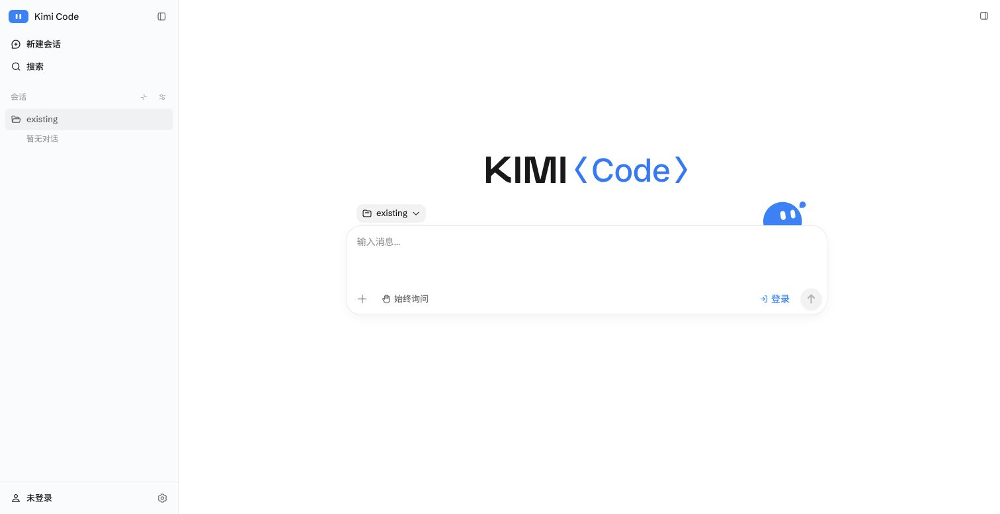

# M3.1 调研依据与可复核证据

调研日期：2026-10-10。对应[详细计划](m3.1-plan.md)，不是M3.1实现验收。调研结论来自官方固定版本源码/发布包、本仓库代码、隔离运行的Kimi界面，以及公开SDK的有限内存探针。

## 1. 基线与证据等级

| 对象 | 固定基线 | 核对方式 |
|---|---|---|
| pi-pane | `c2c39e6f7a84c7e8490bbca587528cb195524e22`，0.2.0收尾 | 当前main源码；[已完成M3验收](m3-final-acceptance.md) |
| pi / pi-ai | 1.1.0；`abe508e1b89912adde45528136c3221eb69acdd7` | 本仓库npm包文档、公开exports、d.ts、JS及sourcemap；官方v1.1.0 tag与固定提交 |
| Kimi Code | `@moonshot-ai/kimi-code@2.1.1`；`242ac230006447f8601e1678c49182bfbae89fe9` | 隔离目录的官方npm包manifest/实际运行；[固定源码manifest](https://github.com/MoonshotAI/kimi-code/blob/242ac230006447f8601e1678c49182bfbae89fe9/apps/kimi-code/package.json) |
| 浏览器实测 | Chrome，macOS arm64 | 通过CUA真实界面操作；临时HOME、KIMI_CODE_HOME及合成项目；未输入日常凭据、未发送模型提示 |

- **源码事实**：接口存在、导出范围、字段及具体执行行为；可以反驳错误假设，但不等于新的pi-pane组合方案已跑通。
- **实机观察**：本次实际点击、填写合成目录并看到结果；只证明记录的操作，不从入口推断完整后台能力。
- **隔离探针**：只证明指定输入/失败条件，不能代替磁盘、跨进程或真实provider测试。
- **方案/待验证**：架构取舍和未来验收；未实现、未通过的项目明确保留为Gate或待办。

认证的6份发布包sourcemap源码与固定上游源码逐字SHA-256核对一致，见[source-verification.json](m3.1/source-verification.json)。这证明所引用代码与测试基线相符，不证明全部npm产物都已做可重现构建。

## 2. Kimi 2.1.1 本次实机观察

启动方式是官方发布包的 `kimi web --host 127.0.0.1 --port <临时端口> --no-open`，用于检查其网页功能。**本次未重新执行TUI `/web`交接**，因此不把这些截图当新的交接生命周期证据；该部分仍参考既有[M3交接调研](m3-handoff-spike.md)及[官方 `/web` 源码](https://github.com/MoonshotAI/kimi-code/blob/242ac230006447f8601e1678c49182bfbae89fe9/apps/kimi-code/src/tui/commands/web.ts#L23)。

只传入必要PATH/终端环境及临时HOME/KIMI_CODE_HOME，不继承provider key环境。启动目录是合成workspace，另建并列的projects/existing目录。未登录Kimi账号，未发送提示词，未操作真实用户项目。未完整审计参考软件本身的所有网络请求，不能把“未调用模型”扩大为“参考软件绝无遥测/网络”。

| ID | 操作与实际结果 | 证明了什么 | 没有证明什么 |
|---|---|---|---|
| K-01 | 跳过首次引导，点击“选择文件夹…”；出现“添加工作区”、目录层级、子目录、绝对路径入口 | 网页有主机目录选择流程 | 不证明存在mkdir/git clone按钮或文件管理器 |
| K-02 | 输入启动目录之外的合成existing绝对路径，点击添加；侧栏出现existing及“暂无对话”，中央当前项目变为existing | 可添加别的已有主机目录；项目不以已有对话为前提 | 未调用模型，不证明该目录内工具实际执行路径 |
| K-03 | 刷新页面，existing与“暂无对话”仍显示 | 空工作区在页面刷新后仍保留 | 未重启Kimi服务，不推断其磁盘存储格式或跨服务重启保证 |
| K-04 | 打开设置→通用，看到外观、语言、字号、通知/声音和数据选项 | 主题/外观是独立设置流程；有浅/深/跟系统选项 | 未逐项切换/重启验证，不证明存储作用域和热应用实现 |
| K-05 | 打开设置→账户；未登录，存在登录入口 | 网页账户入口真实存在，独立于模型选择 | 未启动或完成真实OAuth，不证明全部远程登录流程 |
| K-06 | 打开模型供应商→添加；看到协议、API key、Base URL、模型ID/上下文表单；取消退出 | 自定义服务商配置独立于账号登录 | 未输入key、未保存、未验证自定义provider可请求 |

K-02完成后的截图：

其他证据：[目录选择器](images/m3.1/kimi-project-picker.png)、[通用设置](images/m3.1/kimi-general.png)、[账户入口](images/m3.1/kimi-account.png)、[添加供应商表单](images/m3.1/kimi-provider-form.png)。截图均为参考软件，不是pi-pane新界面。

哈希及观察范围见[research-evidence.json](m3.1/research-evidence.json)。浏览器标签已关闭，调研服务已停止，临时HOME/项目及访问令牌文件已清理；保留的图片没有用户凭据。原始任务证据在被Git忽略的 `build-artifacts/m3.1/research/`，公开文档不依赖该目录才能阅读。

### 对齐标准与取舍

**判定标准（维护者 2026-10-10 明确）**：对齐不是照搬 Kimi 网页的全部功能，而是 **pi 与 Kimi 都有的同类功能，在网页上保持一致，并各用各的语义**。例如 pi 有自己的 `/login`，Kimi 也有自己的登录，网页就应当提供 pi 的登录。只有 Kimi 有、pi 没有对应语义的功能不算缺口；只有 pi 有的功能（如 `/tree`、`/trust`）按 pi 自身需要处理，与对齐无关。

交集盘点的来源：pi 侧是 1.1.0 发布包的 `docs/slash-commands.md`、`packages.md`、`mcp.md`、`models.md`、`sessions.md` 和 RPC 类型；Kimi 侧是上表实机观察、M3 阶段的界面核对（`build-artifacts/kimi-alignment/current/audit.json`），以及固定提交 `242ac23` 的 `apps/kimi-code/dist-web` 网页包内的中文界面文案。该网页包与桌面端共用，文案存在不等于网页一定显示：“快捷键”“浏览器”设置页不在网页截图中，终端面板未在网页确认，均未计入。本次没有为此重新运行 Kimi。

| 同类功能 | Kimi 网页 | pi 原生 | pi-pane 0.2.0 | M3.1 决定 |
|---|---|---|---|---|
| 项目/工作区 | 添加已有目录、空工作区、按工作区组织会话 | 在目录中运行 `pi`，会话按 cwd 分组 | 只按已有会话的 cwd 分组 | P0 必交 |
| 登录/退出 | Kimi 设备码登录 | `/login`、`/logout` | 终端专用 | P1 必交，按 provider 声明支持矩阵 |
| 自定义模型供应商 | 表单：协议、API Key、Base URL、模型列表 | `models.json` 兼容端点（无交互入口） | 无 | **P1 必交**：结构化表单，见主计划 5.4 |
| 外观 | 浅/深/跟随系统、字号 | 主题 | 交接时的主题快照 | P1 必交，并接 pi 主题 |
| 设置与默认值 | 默认模型、默认思考、消息折叠 | `/settings` | `/settings` 跳到资源页 | P2 必交，首批可编辑清单 |
| 模型与思考、会话基本操作、压缩、队列、@文件、图片 | 都有 | 都有 | 已有 | 保持 |
| 删除会话 | 删除 | 会话选择器内删除 | 无 | **P2 必交**，见主计划 4.5 |
| 导出会话 | 导出 | `/export`，RPC `export_html` | 标为终端专用 | **P2 必交** |
| 复制回复 | 复制对话/最终总结 | `/copy`，RPC `get_last_assistant_text` | 标为终端专用 | **P2 必交** |
| 会话信息与用量 | 会话状态面板、上下文用量 | `/session`，RPC `get_session_stats` | `/session` 跳到资源页，无统计 | **P2 必交** |
| 常用模型范围 | 收藏模型 | `/scoped-models` | 无 | 本期只读，后续补齐 |
| 资源/插件管理 | 安装、更新、移除、启停 | `pi install`、`pi config` | 只读资源列表 | 本期只读，后续补齐 |
| MCP 管理 | 插件页显示并启停 MCP 服务 | `/mcp`（查看、登录、重连、启停） | 无 | 本期只读，后续补齐 |

“网页创建磁盘目录”不来自对齐：本次未见 Kimi 有 mkdir 入口，它是按本产品需求新增的 P0 目标。

不属于对齐范围（pi 没有同类功能）：多会话并行运行、权限模式与工具审批、计划/目标/Swarm、后台任务与定时任务、撤销消息、侧边聊天、归档/置顶/完成标记/批量管理/自动标题、系统通知与提示音、界面语言、套餐用量、云中继。

### 界面风格缺口

维护者 2026-10-10 提出：当前网页的设计风格需要改，与功能缺口并列。对照两边的实际截图（pi-pane 见 [0.2.0 桌面截图](images/m3-0.2.0-desktop.jpg)，Kimi 见上文各图）：

| 方面 | pi-pane 0.2.0 | Kimi 2.1.1 网页 |
|---|---|---|
| 整体 | 固定深色，描边密集的工具面板 | 默认浅色并支持明暗，留白多 |
| 侧栏 | 新建、重命名、克隆、搜索、会话/分支树逐个堆成按钮 | 导航列表：新建会话、搜索、按工作区分组的会话 |
| 空状态与输入 | 输入区固定在底部，上下常驻说明文字 | 居中输入框，带项目选择器 |
| 设置 | 与资源一起挤在右侧面板的标签里 | 独立弹窗，左侧分类导航 |
| 控件 | 边框明显、圆角小、等宽字体路径占一行 | 弱边框、大圆角卡片 |

方向已由维护者于 2026-10-10 确认为三层划分：页面结构以 Kimi 2.1.1 网页为参照；视觉语言（字体、间距、形状、组件状态）由 pi-pane 自行设计，不照抄 Kimi 的观感；颜色以及纹样类装饰（例如青花瓷纹样）归主题层。依据是 pi 主题只含颜色：仓库自带主题为 56 个颜色值，映射后只产生颜色变量。因此设计不写死颜色，颜色上的辨识度通过重做两个默认主题表达；装饰是 pi-pane 对主题的扩展；维护者随后决定把装饰的加载机制和随包发布的青花瓷主题纳入本期。详见主计划第 7 节。

## 3. pi 可行性证据地图

| 判断 | 关键公开依据 | 当前实现缺口及后续证明 |
|---|---|---|
| cwd是实际运行时边界 | [SDK](https://github.com/earendil-works/pi/blob/abe508e1b89912adde45528136c3221eb69acdd7/packages/coding-agent/docs/sdk.md#L54)、[运行时](https://github.com/earendil-works/pi/blob/abe508e1b89912adde45528136c3221eb69acdd7/packages/coding-agent/src/core/agent-session-runtime.ts#L196) | 项目附录P-E01–07；G1/G2验证跨项目启动、资源及参数 |
| 标准new_session不接受cwd | [RPC](https://github.com/earendil-works/pi/blob/abe508e1b89912adde45528136c3221eb69acdd7/packages/coding-agent/docs/rpc-commands.md#L130) | 不伪造参数；采用标准CLI目标cwd候选路线 |
| 空会话延后持久化 | [SessionManager](https://github.com/earendil-works/pi/blob/abe508e1b89912adde45528136c3221eb69acdd7/packages/coding-agent/src/core/session-manager.ts#L1161) | 不能把返回sessionFile等同文件存在；独立registry、预锁、首次落盘验证 |
| 项目信任有公开存储接口 | [公共导出](https://github.com/earendil-works/pi/blob/abe508e1b89912adde45528136c3221eb69acdd7/packages/coding-agent/src/index.ts#L392)、[配置规则](https://github.com/earendil-works/pi/blob/abe508e1b89912adde45528136c3221eb69acdd7/packages/coding-agent/docs/configuration.md) | 处理无TUI的信任流程、global hook及一次性授权范围 |
| 登录/退出有公开SDK | [ModelRuntime](https://github.com/earendil-works/pi/blob/abe508e1b89912adde45528136c3221eb69acdd7/packages/coding-agent/src/core/model-runtime.ts#L819)、[AuthInteraction](https://github.com/earendil-works/pi/blob/abe508e1b89912adde45528136c3221eb69acdd7/packages/ai/src/auth/types.ts#L117) | 需宿主适配和owner定向交互；不能另建会话writer |
| auth保存与child模型更新是两个问题 | [AuthStorage](https://github.com/earendil-works/pi/blob/abe508e1b89912adde45528136c3221eb69acdd7/packages/coding-agent/src/core/auth-storage.ts#L401)、[RPC实现](https://github.com/earendil-works/pi/blob/abe508e1b89912adde45528136c3221eb69acdd7/packages/coding-agent/src/modes/rpc/rpc-mode.ts) | G3检验新凭据应用、退出来源及同步失败；不能只刷新下拉框 |
| 设置层级与保存结果不可混淆 | [SettingsManager](https://github.com/earendil-works/pi/blob/abe508e1b89912adde45528136c3221eb69acdd7/packages/coding-agent/src/core/settings-manager.ts#L706) | 内存探针已证global覆盖/flush失败语义；G4补磁盘/并发/实际RPC效果 |
| 主题的公共接口有边界 | [主题规范](https://github.com/earendil-works/pi/blob/abe508e1b89912adde45528136c3221eb69acdd7/packages/coding-agent/docs/themes.md)、[根导出](https://github.com/earendil-works/pi/blob/abe508e1b89912adde45528136c3221eb69acdd7/packages/coding-agent/src/index.ts#L473) | 部分内部loader不在根exports；G4验证安全发现/解析，不重复加载项目扩展 |

完整证据链接和确切代码行见[项目23条索引](m3.1/projects.md#2-证据索引)、[认证源码与provider表](m3.1/auth.md)、[设置16条源码索引](m3.1/settings.md#2-一手固定依据)。设置附录逐项覆盖官方设置表的71个字段，不用“等等”代替范围清单。

## 4. 本次实际运行的 SDK 探针

使用公开 `SettingsManager.fromStorage` 加合成内存storage，三项均完成：

1. global.theme修改后，project.theme仍是有效值；无关字段保留。
2. storage抛写入异常后，`flush()`仍resolve；内存已变、持久化值未变，`drainErrors()`报告错误。
3. 外部先修改相邻嵌套字段后，setter保存另一字段，保留外部变化和无关字段。

结果：[settings-probe-results.json](m3.1/settings-probe-results.json)；可复现片段见[设置附录第10节](m3.1/settings.md#10-探针可复现要点)。未读取日常settings/auth，未请求模型。三个内存探针通过不代表计划中的20项主题/设置验收已通过。

## 5. 尚无运行证据的关键问题

本节写于原型运行之前。G1–G5 的隔离原型其后已运行，结果见[门槛验证记录](m3.1-gates.md)；下列各项中仍未覆盖的部分以该记录第 7 节为准。

- 标准CLI在新项目未落盘会话路径上的预锁/激活/恢复组合：有源码依据，G1尚未执行。
- 跨项目信任、相对启动资源、慢shutdown、关闭阶段追加、扩展veto缺口及候选失败恢复：G2尚未执行。
- 不加载额外项目扩展的认证host、全部交互类型、secret字面值、凭据保存后的RPC替换、真实provider：G3及真实试用尚未执行。
- 无副作用的完整主题来源发现、项目覆盖下实际设置效果、真实磁盘失败/跨进程写入：G4尚未执行。
- 本次Kimi账户/主题只验证入口与显示，没有完成供应商登录或所有设置保存。没有把Kimi能力直接等价于pi能力。
- 自定义供应商的 `models.json` 结构化读写、密钥保存位置、会话删除与导出：有文档与类型依据，G5尚未执行。
- 界面风格改版：方向已确认，但只有截图对照，没有设计稿与规范。
- 主题装饰：独立清单不影响 pi 加载主题目录、按来源路径绑定、现有 CSP 下遮罩着色，均为设计假设，并入 G4 验证；青花瓷主题的配色与纹样素材尚未制作。

因此可以有依据地决定M3.1值得推进，并明确分解工作，但现在不能声称新架构所有细节已跑通。主计划把上述问题设为依赖门槛，而不是留到发布时才发现。

## 6. 文档复核与变更范围

项目、认证、主题/设置三个专题分别独立核对后，又交叉检查主计划。已修正的重点包括：无Bridge时仍需宿主恢复命令；认证等待期间禁止其他页面启动任务；锁预留后仍要检查外部写入；活跃child崩溃与候选启动失败分开；retry没有可直接回读的RPC状态字段；秘密泄漏验收应排除官方auth文件和owner必要交互。

本轮只新增规划、研究附录、截图及有限探针结果，并增加README入口。没有修改src、构建配置、版本号或日常pi安装，没有发布或推送。
