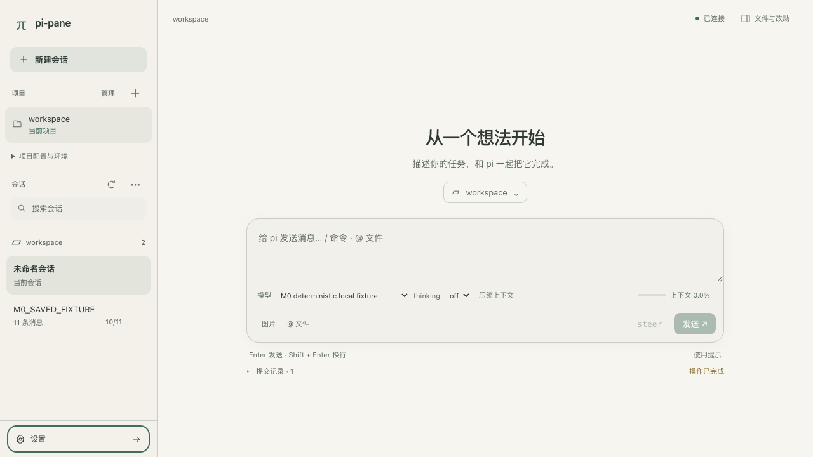
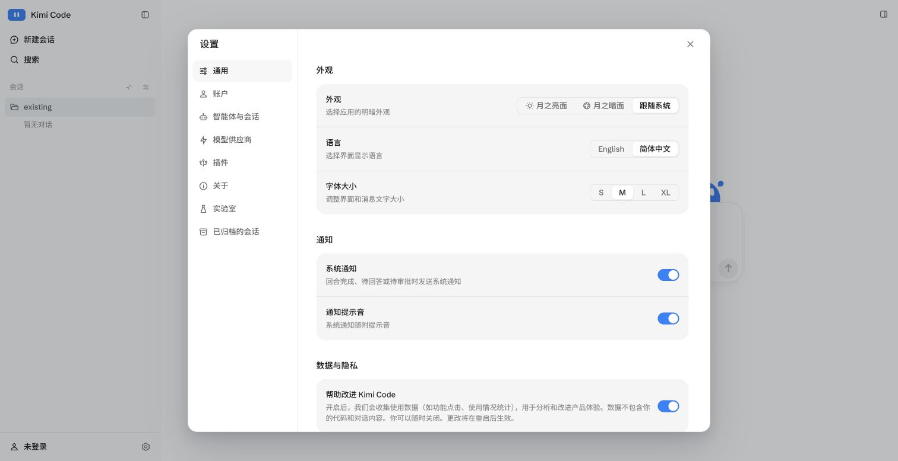
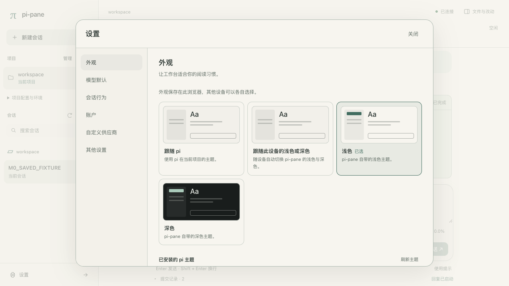
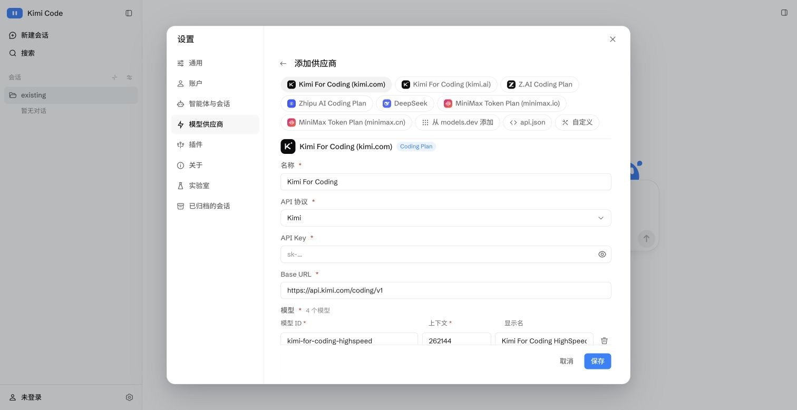
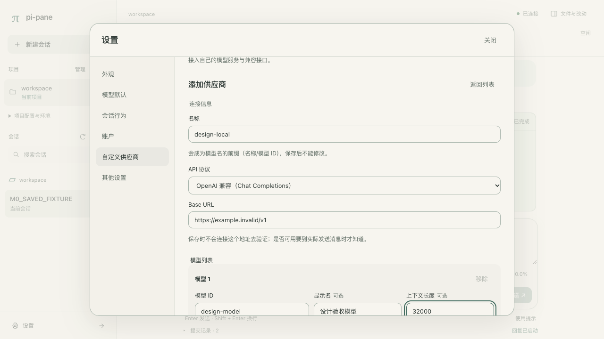
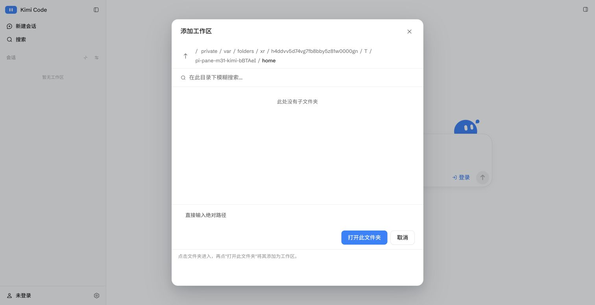
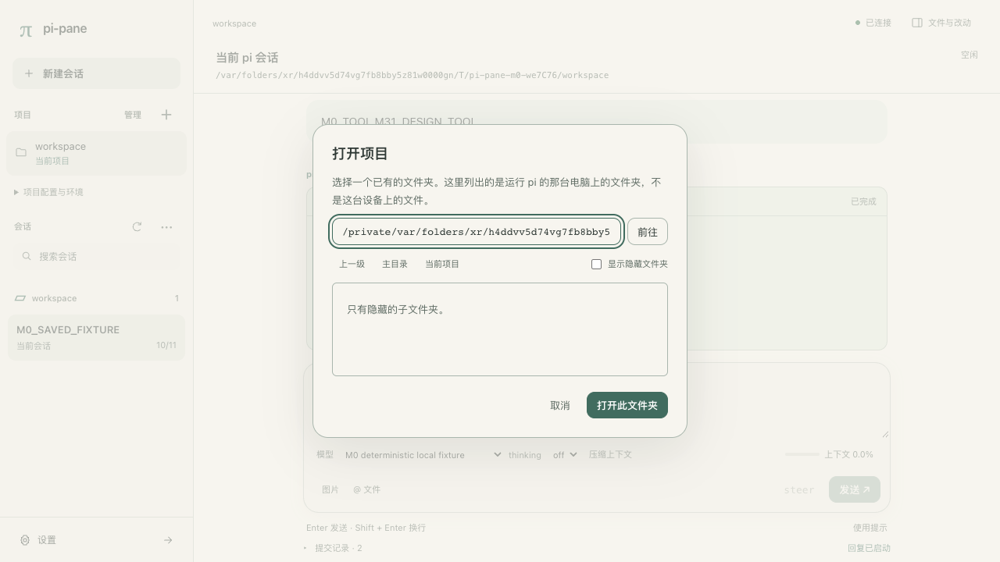
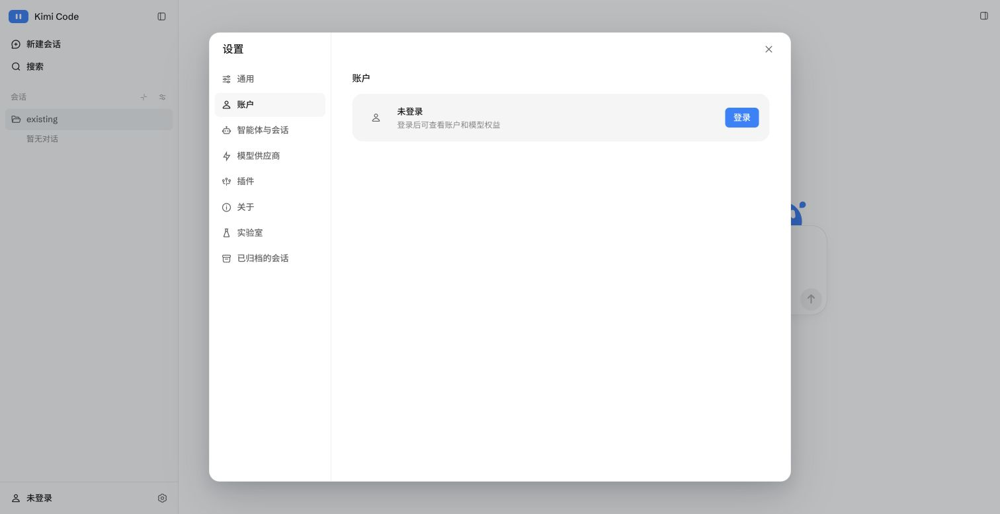
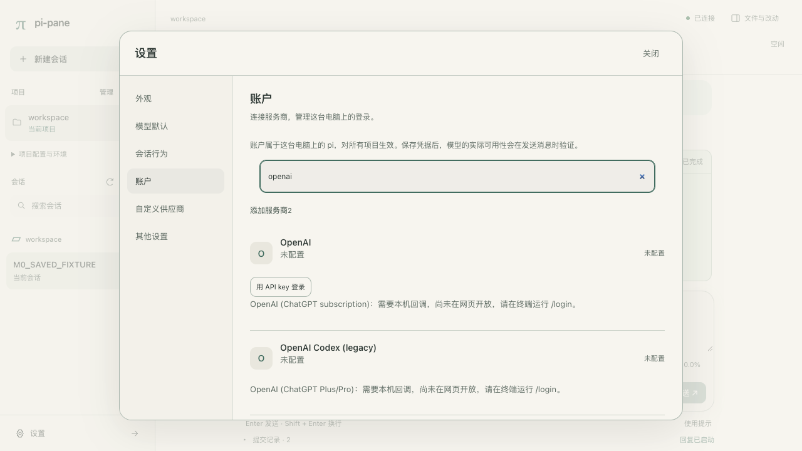

# M31-D 界面规范与走查

2026-10-11。沿用维护者已确认的三层方向：结构参照仓库保存的 Kimi 2.1.1 页面，pi-pane 自己定义排版和组件，颜色与纹样由主题决定。

## 页面方案

| 页面 | 布局与入口 | 本轮评审决定 |
|---|---|---|
| 工作台 | 左侧项目/会话导航；中间对话；右侧文件、Git 与资源 | 品牌收进侧栏；取消占满屏宽的品牌行；当前会话的次要操作收进菜单，保留清晰的新建入口 |
| 空会话 | 中央标题、当前项目入口和输入框 | 输入框位于视觉中心；进入会话后回到底部；不增加虚构示例数据 |
| 设置 | 独立弹窗，左分类、右内容；手机横向分类导航 | 分类有标题与简述；来源信息按需展开；账户、供应商、外观有统一间距 |
| 供应商 | 列表 → 基本信息 → 模型列表 → 保存 | 字段有可见标签；错误靠近字段；密钥继续通过独立登录步骤设置 |
| 项目 | 侧栏列表；打开/创建使用目录弹窗 | 常用导航常驻；移除和信任详情降为次要入口；危险操作保留原确认 |

这是实施前的代码与既有截图评审记录，不代表维护者已验收最终画面。实际页面截图与自动化走查结果在实施后写入门槛验证记录。参考截图保留在 `docs/images/m3.1/`，不引入 Kimi 品牌素材。

## 视觉语言

- 字体：系统无衬线，中文使用 PingFang SC；代码使用系统等宽字体。无需外部字体请求。
- 字号：空态标题 28px；弹窗/分类标题 18px；正文 14px、1.75 行高；控件 13px；辅助说明 12px；紧凑元数据最低 11px。
- 间距：4/8/12/16/24/32px。导航宽 248px，对话内容最大宽 800px，右侧 320px；设置宽 900px、分类宽 180px。
- 圆角：按钮/输入 10px；列表 10px；工具和代码 12px；输入区 20px；弹窗 20px。
- 边框：表单和代码保留 1px 边界；导航项依靠底色和字重区分；不在每层容器叠加描边。
- 阴影：只用于浮层和输入区，由主题阴影角色派生。微交互 120–160ms，仅颜色与阴影；减少动态效果偏好下禁用动画。

## 颜色角色

| 角色 | 用途 |
|---|---|
| `--bg` / `--fg` | 阅读背景与正文 |
| `--fg-muted` / `--fg-dim` | 辅助说明与元数据 |
| `--accent` | 主要动作、链接、选中提示和焦点 |
| `--surface` / `--sidebar-bg` | 输入与浮层表面、导航背景 |
| `--border` / `--hover-bg` | 控件边界、悬停和选中背景 |
| `--shadow-color` | 浮层阴影 |
| `--user-bg` | 用户消息背景 |
| `--err` / `--warn` / `--ok` | 失败、待处理、完成，始终配文字 |
| `--pi-*` | Markdown、代码、diff、工具的 pi 语义颜色 |

布局样式不定义色相。没有宿主主题的首屏使用系统 Canvas/CanvasText；连接后 ThemeMapper 接管。主按钮文字按背景亮度选择黑/白，以保证对比度。默认主题定义在独立 JSON 中，换主题时整体让位。

## 组件状态与可达性

| 组件 | 状态要求 |
|---|---|
| 按钮/导航 | 默认、hover、active、focus-visible、disabled；焦点环 2px，不能只用颜色表达当前项目/会话 |
| 输入/选择 | 可见标签，focus-within，错误关联提示，禁用态；手机输入字号 16px 避免自动缩放 |
| 列表 | 当前项有 aria-current；操作 hover/focus 可见，触屏常驻；空列表和读取失败有文字与重试 |
| 弹窗/抽屉 | 焦点限制在活动层；Escape 关闭；关闭后恢复可用入口；背景 inert |
| 提示 | 保留真实操作结果；删除供应商后仍由 pi 回退模型，页面显示前后模型提示，不增发送拦截 |
| 小屏 | 390×844 无页面横向溢出；左右侧栏为抽屉；设置全屏；触控目标至少 40px |

## 装饰位

装饰盒是独立留白，不位于正文、代码、diff、表单或工具输出下方；无纹样时保留同样尺寸，不改变布局。品牌 `brand` 48×24px；空态 `empty` 160×68px；设置页眉 `settingsHeader` 80×26px；分隔 `divider` 高 16px。仅实际需要的页面使用这些位置。

青花瓷主题的独立清单引用随包发布的原创单色 SVG，按语义主题色作为遮罩着色。关闭装饰或系统请求高对比度/强制颜色时隐藏纹样；手机缩小品牌/空态装饰，并隐藏页眉/分隔装饰。清单和素材校验失败只移除装饰，不影响颜色或内容。

## 实际页面走查（2026-10-11）

以下是系统 Chrome 渲染的产品页面，使用临时 HOME、项目与确定性本地 provider；画面中的 `M0_` 和临时目录是测试夹具。截图没有经过重绘或拼接。桌面视口为 1280×720，手机视口为 390×844（2 倍像素截图）。完整矩阵、布局和颜色测量见 `build-artifacts/m3.1/design/report.json`；仓库保留 15 张代表截图。

| 画面 | 走查结论 |
|---|---|
| [浅色工作台](images/m3.1/ui/desktop-light-workbench.png) | 品牌、新建、项目、会话和底部设置形成单一导航；消息及代码在中间阅读区；输入区收拢模型与思考控件 |
| [浅色空会话](images/m3.1/ui/desktop-light-empty.png)、[深色空会话](images/m3.1/ui/desktop-dark-empty.png) | 标题、项目入口和输入框居中；装饰关闭或不存在时留白尺寸一致 |
| [青花空会话](images/m3.1/ui/desktop-porcelain-empty.png)、[青花工具与 diff](images/m3.1/ui/desktop-porcelain-diff.png) | 纹样只在空态和品牌留白；工具、代码与 diff 保持独立底色与语义颜色，没有纹样压在内容之下 |
| [浅色设置](images/m3.1/ui/desktop-light-settings.png)、[青花设置](images/m3.1/ui/desktop-porcelain-settings.png) | 独立分类弹窗；外观卡片、列表、标签和按钮使用同一字号、边界与间距；内容可在弹窗内纵向滚动 |
| [账户](images/m3.1/ui/desktop-light-accounts.png)、[供应商表单](images/m3.1/ui/desktop-light-provider-form.png)、[字段错误](images/m3.1/ui/desktop-light-provider-error.png) | 列表、表单和错误状态沿用统一组件；原来的登录与供应商行为保持；错误通过文字标明 |
| [项目目录](images/m3.1/ui/desktop-light-project.png) | 仍选择运行 pi 的主机目录；打开和创建位于同一入口，项目管理降为次要操作 |
| [手机工作台](images/m3.1/ui/mobile-light-workbench.png)、[手机设置](images/m3.1/ui/mobile-light-settings.png)、[手机供应商](images/m3.1/ui/mobile-porcelain-provider-form.png)、[手机青花空态](images/m3.1/ui/mobile-porcelain-empty.png) | 左右侧栏变抽屉，设置占满视口且分类可横向滚动；表单和输入区没有页面横向溢出，输入区完整可达 |

键盘走查发现并修复了两个实际问题：折叠菜单里的旧按钮不能作为关闭弹窗后的焦点目标，因此改为恢复到可见的菜单入口；手机 Escape 需要逐层关闭弹窗、菜单、抽屉，因此弹窗存在时抽屉不响应，菜单消费事件后抽屉也不响应。最终脚本覆盖两种 Escape 路径、焦点恢复、Tab/Shift+Tab 限制和可见焦点环。

### 与 Kimi 2.1.1 并排对照结构

参照仅使用仓库已有的实机截图。共同部分沿用信息架构，控件文案和能力保持 pi 的语义；下表中的参考图只用于文档，未进入产品资源。

| 场景 | Kimi 2.1.1 参考 | pi-pane 实际页面 |
|---|---|---|
| 侧栏与空会话：品牌和新建在侧栏上方、设置在底部；空会话由项目入口与居中输入区组成 |  |  |
| 设置：独立弹窗，左侧分类、右侧内容 |  |  |
| 供应商：设置分类内提供基础信息与模型配置；pi-pane 的密钥另走官方登录 |  |  |
| 项目：导航入口打开主机目录选择器；pi-pane 另有明确的新建目录能力 |  |  |
| 账户：设置分类内处理登录与已有配置 |  |  |

### 检查边界

本轮为实施者的页面与源码走查，未将维护者尚未给出的最终视觉认可记为通过。没有逐像素比较基线，也没有真实手机、读屏器或多种浏览器走查。

三款自带主题的正文、辅助文字、弱化文字、强调色与主按钮采样对比度均大于 4.5。脚本对所有五款主题硬断言正文与主按钮至少 4.5；pi 内置 `light` 的 muted/dim 为 4.32/2.81，`dark` 的 dim 为 4.25，它们沿用 pi 的颜色映射。本轮不保证任意 pi 主题的全部弱化文字都满足 AA，也未逐个度量所有代码 token。完整证据与验收状态见[门槛验证第 13 节](m3.1-gates.md#13-m31-d-界面风格改版的实施验证)。
