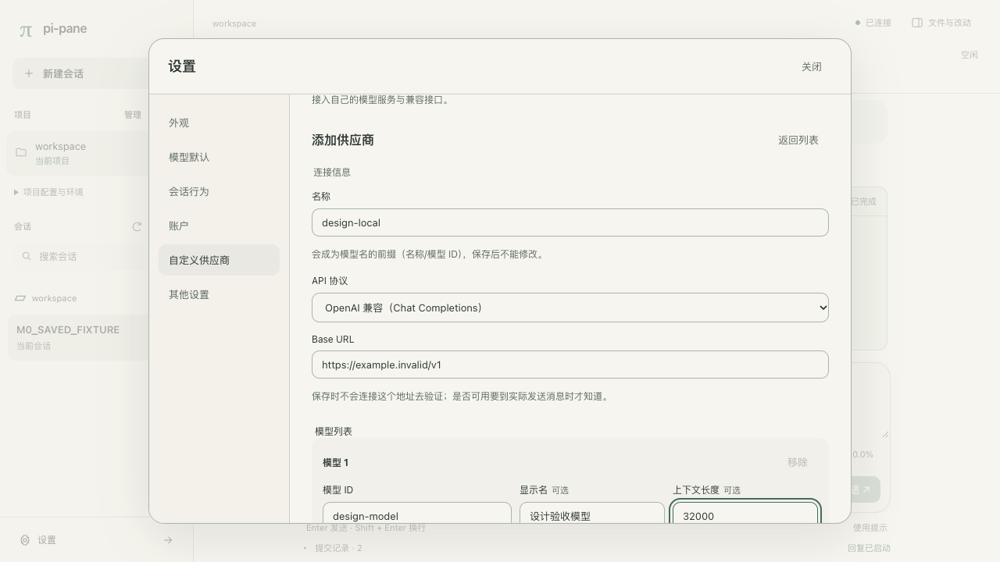

# M31-D 界面规范与走查

2026-10-12。当前规范采用维护者选择的方案 1 + 2，并按反馈把改动、文件和资源做成 Codex 式平面停靠面板：导航、会话与工作区内容处于同一个布局中。pi-pane 保留自己的组件、文案和真实能力；颜色与纹样仍由主题决定。

## 当前设计与预览

[方案 1](../build-artifacts/m3.1/ui-redesign-20261012/design-1.png)、[方案 2](../build-artifacts/m3.1/ui-redesign-20261012/design-2.png)与[选定的合并稿](../build-artifacts/m3.1/ui-redesign-20261012/design-merged.png)是设计示意，来源与选择记录见[设计清单](../build-artifacts/m3.1/ui-redesign-20261012/design-manifest.json)。已采用的工作树页面参考见[桌面停靠面板](../build-artifacts/m3.1/ui-redesign-20261012/preview/59-delivery-desktop-light.jpg)、[手机工作台](../build-artifacts/m3.1/ui-redesign-20261012/preview/61-delivery-mobile-conversation.jpg)和[手机改动页](../build-artifacts/m3.1/ui-redesign-20261012/preview/60-delivery-mobile-diff.jpg)。这些是 rc.4 准备之前的历史设计参考，不代表 rc.4 新产物的最终验收；本机证据不随发布包交付。

当前实现来源为[工作台结构](../src/web/workbench.tsx)、[会话与输入区](../src/web/main.tsx)、[布局样式](../src/web/style.css)及[浅色](../themes/pi-pane-light.json)/[深色](../themes/pi-pane-dark.json)主题。工作树改版的历史实施走查见[重设计 QA](m3.1-redesign-qa.md)；rc.4 新产物的逐页截图仍待最后人工视觉审查。下面的规范描述当前方向，2026-10-11 的旧版走查完整保留在文末历史区。

本轮实际页面与行为证据见 [rc.4 重设计报告](../build-artifacts/releases/0.3.0-rc.4/regression/m31-redesign/report.json)。顶层 15 张代表图已从正式 `regression/m31-design/` 的同名 PNG 逐字节写回，包括[桌面工作台](images/m3.1/ui/desktop-light-workbench.png)、[桌面差异](images/m3.1/ui/desktop-porcelain-diff.png)、[手机工作台](images/m3.1/ui/mobile-light-workbench.png)与[手机设置](images/m3.1/ui/mobile-light-settings.png)。以下“rc.4 当前实施证据”记录本轮范围与数量；实施者检查和自动化通过仍不代替维护者的最终人工视觉认可。

## 页面方案

| 页面 | 布局与入口 | 当前实施要求 |
|---|---|---|
| 工作台 | 左侧项目/会话导航；中间对话；右侧停靠改动、文件与资源 | 只有一条 56px 高的会话页眉，包含会话标题、项目简称、真实运行状态、始终可见的连接文字和面板入口。项目简称的 title 保留完整目录，旁边独立的“查看项目完整路径”按钮以 40×40px 触屏目标打开会话信息，显示完整 cwd。右列直接参与布局，使用平面边界与会话分隔 |
| 空会话 | 中央标题、当前项目入口和输入框 | 输入框位于视觉中心；进入会话后回到底部；不增加虚构示例数据 |
| 改动/文件预览 | 从真实列表选择文件，切换原文件或差异 | 选中文件后隐藏列表，预览成为当前内容；单行文件页眉包含文件名、返回列表和可用操作，返回后恢复列表。差异使用可横向滚动的代码区域，不撑宽工作台 |
| 资源 | 停靠面板内的模型、工具、命令与能力分类 | 保留宿主真实列表、可用状态与既有操作；手机作为独立整页进入和返回 |
| 输入区 | textarea 下方紧凑工具栏 | 图片、文件引用、模型、思考强度、压缩、上下文占用与发送动作都保留。工具栏空间不足时自动换行，运行中的中止、steer 和 followUp 仍可到达，手机不隐藏压缩入口 |
| 设置 | 独立弹窗，桌面左分类、右内容；≤760px 全屏与横向分类导航 | 六个分类保持标题、简述和统一间距；来源信息按需展开；外观使用紧凑预览行，分类与内容分别在规定区域内滚动 |
| 供应商 | 列表 → 基本信息 → 模型列表 → 保存 | 字段有可见标签；错误靠近字段；密钥继续通过独立登录步骤设置 |
| 项目 | 侧栏列表；打开/创建使用目录弹窗 | 常用导航常驻；移除和信任详情降为次要入口；危险操作保留原确认 |

桌面导航可收起。≤760px 时，导航和工作区面板分别成为整页视图，显示明确的“返回对话”入口；非活动视图保留 DOM 与草稿/滚动状态并设为 inert。它们使用页面导航语义，不设置 modal、不绘制抽屉遮罩、不限制 Tab；返回后恢复可用入口。设置、账户登录、项目选择、会话确认和扩展提问仍是真正弹窗。

## 视觉语言

- 字体：系统无衬线，中文使用 PingFang SC；代码使用系统等宽字体。无需外部字体请求。
- 字号：空态标题桌面 26px、手机 24px；弹窗/分类标题 18px；正文 15px、1.75 行高；文件与差异 13px；控件 12–13px；辅助说明 11–12px；紧凑元数据最低 11px。
- 间距：4/8/12/16/24/32px。导航宽 224px，在 761–1100px 桌面宽度内缩为 200px；对话内容最大宽 800px。打开工作区面板后，右列最小 300px，并与对话列按约 1:1 分配剩余宽度；两列都允许内部内容收缩和滚动。设置最大宽 880px、分类宽 168px。
- 圆角：按钮 8px；独立输入字段 10px；列表、工具和代码 8px；输入区 12px；真正弹窗 20px，手机 16px。
- 边框：表单和代码保留 1px 边界；导航项依靠底色和字重区分；不在每层容器叠加描边。
- 阴影：工作区停靠面板和输入区保持平面表面；阴影只用于真正弹窗及菜单，由主题阴影角色派生。微交互 120–160ms，仅颜色与阴影；减少动态效果偏好下禁用动画。

## 颜色角色

| 角色 | 用途 |
|---|---|
| `--bg` / `--fg` | 阅读背景与正文 |
| `--fg-muted` / `--fg-dim` | 辅助说明与元数据 |
| `--accent` | 主要动作、链接、选中提示和焦点 |
| `--surface` / `--sidebar-bg` | 输入、预览与弹窗表面、导航背景 |
| `--border` / `--hover-bg` | 控件边界、悬停和选中背景 |
| `--shadow-color` | 浮层阴影 |
| `--user-bg` | 用户消息背景 |
| `--err` / `--warn` / `--ok` | 失败、待处理、完成，始终配文字 |
| `--pi-*` | Markdown、代码、diff、工具的 pi 语义颜色 |

自带浅色和深色主题采用冷灰阅读表面与蓝色强调色，定义在独立 JSON 中。布局样式不定义色相；外部 pi 主题的颜色映射继续保留，切换主题时由 ThemeMapper 接管全部语义颜色。没有宿主主题的首屏使用系统 Canvas/CanvasText。主按钮文字按背景亮度选择黑/白；颜色与代码 token 的实际可读性需要在本轮页面上重新检查，旧版采样不直接沿用。

## 组件状态与可达性

| 组件 | 状态要求 |
|---|---|
| 按钮/导航 | 默认、hover、active、focus-visible、disabled；焦点环 2px，不能只用颜色表达当前项目/会话 |
| 输入/选择 | 表单有可见标签、focus-within、错误关联提示和禁用态；紧凑工具栏保留完整的 aria 标签/title；手机输入、搜索、textarea 与 select 字号至少 16px |
| 项目与连接状态 | 项目简称旁的独立按钮可触屏打开完整路径，title 只作补充；连接文字始终可见，并配状态点，不只依靠颜色或悬停表达 |
| 列表 | 当前项有 aria-current；操作 hover/focus 可见，触屏常驻；空列表和读取失败有文字与重试 |
| 桌面停靠面板 | 可见导航、会话与面板共同参与键盘顺序，不把会话背景设为 inert，不设置 aria-modal，不限制 Tab |
| 手机整页导航/面板 | 非活动页面保留 DOM 并 inert，当前页可自然使用 Tab；返回或 Escape 恢复可见入口；改变视口后不把焦点留在隐藏控件上 |
| 真正弹窗 | 设置、账户、项目、会话确认与扩展提问仍限制焦点在活动层；Escape 关闭；关闭后恢复可用入口；背景 inert |
| 提示 | 保留真实操作结果；删除供应商后仍由 pi 回退模型，页面显示前后模型提示，不增发送拦截 |
| 小屏 | 390×844 与 320px 宽视口无页面横向溢出；导航和检查面板为整页；≤760px 设置全屏且分类横向滚动；交互目标至少 40×40px，checkbox 可由 label 提供命中范围；工具栏控件换行后仍完整可达 |

## 装饰位

装饰盒是独立留白，不位于正文、代码、diff、表单或工具输出下方；无纹样时保留同样尺寸，不改变布局。当前侧栏品牌 `brand` 32×24px，手机 30×20px；空态 `empty` 160×68px，手机 120×48px；设置页眉 `settingsHeader` 80×26px；分隔 `divider` 高 16px。仅实际需要的页面使用这些位置。

青花瓷主题的独立清单引用随包发布的原创单色 SVG，按语义主题色作为遮罩着色。关闭装饰或系统请求高对比度/强制颜色时隐藏纹样；手机缩小品牌/空态装饰，并隐藏页眉/分隔装饰。清单和素材校验失败只移除装饰，不影响颜色或内容。

## rc.4 当前实施证据

本节的 rc.4 实际运行发生于北京时间 2026-10-12，报告时间戳使用 UTC；代表图于北京时间 2026-10-13 写回。正式矩阵使用候选关联的 built checkout `dist`；精确安装另以同一 tarball 在临时 HOME、agent 和 npm cache 中执行。两者分别记录，不把预跑、旧 rc.3 图或独立补证混入正式矩阵数量。画面中的 `M0_`、`M31_`、单个文件与临时目录均是本机确定性夹具；截图没有重绘、拼接、裁切或重压。

| 证据 | 范围与实际结果 |
|---|---|
| [正式矩阵](../build-artifacts/releases/0.3.0-rc.4/regression/summary.json) | 25 次执行，293/293 项；真实 TUI → `/web` → RPC、本机确定性/loopback provider、临时 HOME 与环境 allowlist。它记录候选关联与工作树构建字节，精确安装为独立门槛 |
| [M31-D 重设计](../build-artifacts/releases/0.3.0-rc.4/regression/m31-redesign/report.json) | 1280×720、1024×768、390×844、320×740 四个视口，各 9 项，合计 36/36；覆盖桌面停靠/收起、手机整页进入/返回、真实设置弹窗、文件与 diff 引用、资源/模型/命令、运行中 steer/followUp/中止及视口转换 |
| 同一重设计报告中的 `focusPaths` / `08-responsive` | 五类请求路径在四个视口共 96 条焦点恢复结果：92 条恢复到精确指定控件，4 条在原导航搜索控件变为隐藏后恢复到可用入口。96 条结果均可见、非 inert、非禁用；它们是 36 项内部观察，不另增加测试总数 |
| [页面/主题走查](../build-artifacts/releases/0.3.0-rc.4/regression/m31-design/report.json) | 20/20；包含浅色、深色、青花及 pi 主题的实际页面、代码、工具、diff、表单、错误、空态与装饰/键盘检查。下面 15 张代表图全部来自该正式组 |
| [精确安装](../build-artifacts/releases/0.3.0-rc.4/install/report.json) | 5/5；向临时本机模拟 registry 提供原 tarball，经 `pi install` 安装，不重建；核实包内预构建页面、扩展、主题及逐文件字节。不是公网发布验收 |
| [精确安装后的桌面/手机完整主流程](../build-artifacts/releases/0.3.0-rc.4/install/integration/report.json) | 20/20；实际扩展来自临时安装目录，完成项目 A/B、账户/供应商、青花主题、公开工具真实写入、草稿返回和刷新。此 20 项是安装门槛第 5 项的内部证据，单独报告，不与 5 或 293 相加成一个总数 |
| [并发与故障恢复重复检查](../build-artifacts/releases/0.3.0-rc.4/repeats/summary.json) | 额外 6 次独立执行：并发 3 次，各 7/7；故障恢复 3 次，各 17/17。全部保持候选/源码/构建内容不变，清理完成；不并入上面的 25 次正式执行 |

上述矩阵与精确安装关联的 tarball SHA-256 为 `2ef4d9361a8d7fe1156f264452336172dc393bc06dd4f774f28d4a227925317e`。真实远端模型与真实供应商/OAuth 登录没有纳入这些运行；loopback 工具主流程和 synthetic 登录是本机夹具，不能代替真实服务商验证。

四视口检查实际点击了项目简称旁的“查看项目完整路径”按钮：触屏命中范围为 40×40px，打开会话信息显示完整主机 cwd，关闭后恢复按钮焦点；`title` 仅作补充。连接文字在所有视口均测量为完整可见，与状态点共同表达连接状态。手机导航/检查器的“返回对话”以及 Escape 分别验证从 header、composer、真实设置和扩展提问进入后的恢复；手机非活动视图 inert，当前整页自然遍历 Tab，不采用工作区弹窗陷阱。

### 当前 15 张代表图

桌面 PNG 为 1280×720；手机 PNG 为 780×1688，对应 390×844 CSS 视口的 2 倍输出。320px 及 1024px、停靠/收起等补充状态保留在正式重设计 artifact 中，没有另加仓库图片。

| 画面 | 实际展示内容 |
|---|---|
| [浅色工作台](images/m3.1/ui/desktop-light-workbench.png) | 单一会话页眉、常驻导航、Markdown/代码/表格与底部 composer |
| [浅色空会话](images/m3.1/ui/desktop-light-empty.png)、[深色空会话](images/m3.1/ui/desktop-dark-empty.png) | 居中的任务起点、项目入口和空草稿输入区 |
| [青花空会话](images/m3.1/ui/desktop-porcelain-empty.png)、[青花工具与停靠 diff](images/m3.1/ui/desktop-porcelain-diff.png) | 纹样位于留白，真实完成工具参数/结果与已加载红删绿增差异并存 |
| [浅色设置](images/m3.1/ui/desktop-light-settings.png)、[青花设置](images/m3.1/ui/desktop-porcelain-settings.png) | 真正设置 dialog、六分类与主题卡片 |
| [账户](images/m3.1/ui/desktop-light-accounts.png)、[供应商表单](images/m3.1/ui/desktop-light-provider-form.png)、[字段错误](images/m3.1/ui/desktop-light-provider-error.png) | 真实未配置账户列表、字段区域及聚焦的地址错误；供应商图是滚动位置，不声称保存/密钥区在同一屏 |
| [项目目录](images/m3.1/ui/desktop-light-project.png) | 主机目录说明、路径输入、目录导航与打开/取消 |
| [手机工作台](images/m3.1/ui/mobile-light-workbench.png)、[手机设置](images/m3.1/ui/mobile-light-settings.png) | 可见连接状态、窄宽度阅读与 composer；真正设置全屏并横向分类 |
| [手机青花供应商](images/m3.1/ui/mobile-porcelain-provider-form.png)、[手机青花空态](images/m3.1/ui/mobile-porcelain-empty.png) | 单列表单与说明换行；空态纹样、项目入口和 composer 不互相覆盖 |

[最终实施者读图记录](../build-artifacts/releases/0.3.0-rc.4/preparation/screenshots-final-review.md)逐张核对了这 15 张图及 7 张补充图的存在性、SHA、尺寸和内容，没有发现新增可见 P1/P2。[复制记录](../build-artifacts/releases/0.3.0-rc.4/preparation/screenshots-copy.json)确认所有当前代表图目标 SHA 等于正式源 SHA，历史 `history/rc3/` 的 15 张图字节不变。精确安装包的[桌面真实工具完成态](../build-artifacts/releases/0.3.0-rc.4/install/integration/desktop-tool-result.png)和[手机真实工具完成态](../build-artifacts/releases/0.3.0-rc.4/install/integration/mobile-tool-result.png)另保留在安装 artifact 中。

维护者最终人工视觉认可仍未记为通过；这些检查不声称逐像素复刻概念稿、物理手机/软键盘验证、读屏器或多浏览器符合性。下方历史区保持原文与旧图引用，包括当时的状态描述，不作为本轮验收。

## 历史记录：2026-10-11 旧版页面

以下内容完整保留 2026-10-11 的实施走查、截图和检查边界，描述的是改版前的页面与抽屉布局。它不再作为当前规范或本轮验收；历史 rc.3 证据同样不代表 2026-10-12 改版后的产物。原段落中的“本轮”仅指当时的历史走查。历史图片保存在 `docs/images/m3.1/ui/history/rc3/`，冻结前从原代表图逐字节复制；当前代表图将在新产物验证后另行更新。

## 实际页面走查（2026-10-11）

以下是系统 Chrome 渲染的产品页面，使用临时 HOME、项目与确定性本地 provider；画面中的 `M0_` 和临时目录是测试夹具。截图没有经过重绘或拼接。桌面视口为 1280×720，手机视口为 390×844（2 倍像素截图）。完整矩阵、布局和颜色测量见 `build-artifacts/m3.1/design/report.json`；仓库保留 15 张代表截图。

| 画面 | 走查结论 |
|---|---|
| [浅色工作台](images/m3.1/ui/history/rc3/desktop-light-workbench.png) | 品牌、新建、项目、会话和底部设置形成单一导航；消息及代码在中间阅读区；输入区收拢模型与思考控件 |
| [浅色空会话](images/m3.1/ui/history/rc3/desktop-light-empty.png)、[深色空会话](images/m3.1/ui/history/rc3/desktop-dark-empty.png) | 标题、项目入口和输入框居中；装饰关闭或不存在时留白尺寸一致 |
| [青花空会话](images/m3.1/ui/history/rc3/desktop-porcelain-empty.png)、[青花工具与 diff](images/m3.1/ui/history/rc3/desktop-porcelain-diff.png) | 纹样只在空态和品牌留白；工具、代码与 diff 保持独立底色与语义颜色，没有纹样压在内容之下 |
| [浅色设置](images/m3.1/ui/history/rc3/desktop-light-settings.png)、[青花设置](images/m3.1/ui/history/rc3/desktop-porcelain-settings.png) | 独立分类弹窗；外观卡片、列表、标签和按钮使用同一字号、边界与间距；内容可在弹窗内纵向滚动 |
| [账户](images/m3.1/ui/history/rc3/desktop-light-accounts.png)、[供应商表单](images/m3.1/ui/history/rc3/desktop-light-provider-form.png)、[字段错误](images/m3.1/ui/history/rc3/desktop-light-provider-error.png) | 列表、表单和错误状态沿用统一组件；原来的登录与供应商行为保持；错误通过文字标明 |
| [项目目录](images/m3.1/ui/history/rc3/desktop-light-project.png) | 仍选择运行 pi 的主机目录；打开和创建位于同一入口，项目管理降为次要操作 |
| [手机工作台](images/m3.1/ui/history/rc3/mobile-light-workbench.png)、[手机设置](images/m3.1/ui/history/rc3/mobile-light-settings.png)、[手机供应商](images/m3.1/ui/history/rc3/mobile-porcelain-provider-form.png)、[手机青花空态](images/m3.1/ui/history/rc3/mobile-porcelain-empty.png) | 左右侧栏变抽屉，设置占满视口且分类可横向滚动；表单和输入区没有页面横向溢出，输入区完整可达 |

键盘走查发现并修复了两个实际问题：折叠菜单里的旧按钮不能作为关闭弹窗后的焦点目标，因此改为恢复到可见的菜单入口；手机 Escape 需要逐层关闭弹窗、菜单、抽屉，因此弹窗存在时抽屉不响应，菜单消费事件后抽屉也不响应。最终脚本覆盖两种 Escape 路径、焦点恢复、Tab/Shift+Tab 限制和可见焦点环。

### 与 Kimi 2.1.1 并排对照结构

参照仅使用仓库已有的实机截图。共同部分沿用信息架构，控件文案和能力保持 pi 的语义；下表中的参考图只用于文档，未进入产品资源。

| 场景 | Kimi 2.1.1 参考 | pi-pane 实际页面 |
|---|---|---|
| 侧栏与空会话：品牌和新建在侧栏上方、设置在底部；空会话由项目入口与居中输入区组成 |  |  |
| 设置：独立弹窗，左侧分类、右侧内容 |  |  |
| 供应商：设置分类内提供基础信息与模型配置；pi-pane 的密钥另走官方登录 |  |  |
| 项目：导航入口打开主机目录选择器；pi-pane 另有明确的新建目录能力 |  |  |
| 账户：设置分类内处理登录与已有配置 |  |  |

### 检查边界

本轮为实施者的页面与源码走查，未将维护者尚未给出的最终视觉认可记为通过。没有逐像素比较基线，也没有真实手机、读屏器或多种浏览器走查。

三款自带主题的正文、辅助文字、弱化文字、强调色与主按钮采样对比度均大于 4.5。脚本对所有五款主题硬断言正文与主按钮至少 4.5；pi 内置 `light` 的 muted/dim 为 4.32/2.81，`dark` 的 dim 为 4.25，它们沿用 pi 的颜色映射。本轮不保证任意 pi 主题的全部弱化文字都满足 AA，也未逐个度量所有代码 token。完整证据与验收状态见[门槛验证第 13 节](m3.1-gates.md#13-m31-d-界面风格改版的实施验证)。

## 2026-10-12 工作树实施证据（历史）

本段记录 rc.4 准备之前的 1 + 2 合并方案实施。完整设计对照、问题修复历史、当时的 69 个测量状态、23 项交互检查和验证边界见[工作树设计 QA](m3.1-redesign-qa.md)及[实际截图画廊](../build-artifacts/m3.1/ui-redesign-20261012/preview/report.html)。原始 Git 标头与完整 patch 可在预览底部展开，不占据默认代码阅读区。

这些是历史实施者验证结论，未代替 rc.4 新产物的回归、精确安装或维护者逐页最终视觉认可。
